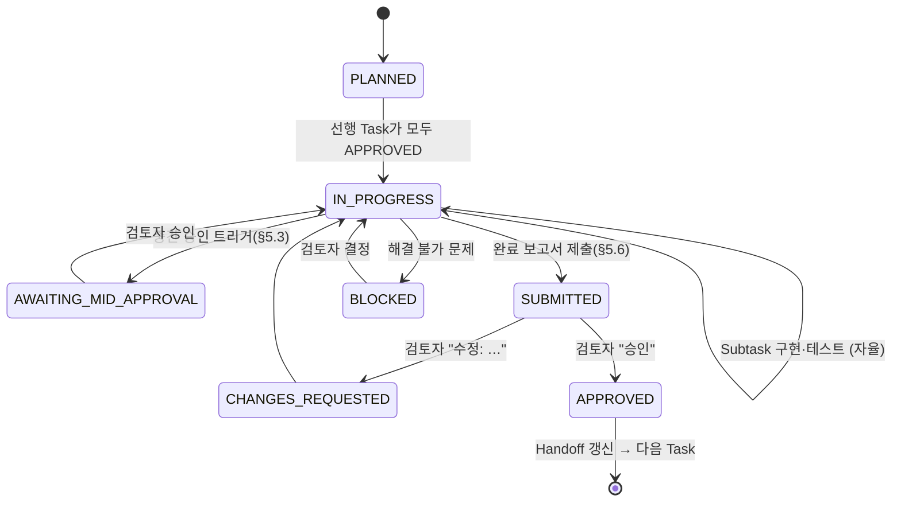

# SKILL_KIT_V2_DEVELOPMENT_PROMPT.md

> **대상 실행자:** Claude Code
> **대상 저장소:** https://github.com/kimcheolhui9846/skill_kit_kch (기본 브랜치 `main`)
> **작성일:** 2026-10-31
> **문서 성격:** 실행 지시서. 기획 소개 문서가 아니다. 이 문서의 지시는 명령형이며, "권장안"으로 표시된 항목만 근거를 들어 바꿀 수 있다.
> **검토자:** 이 문서에서 "검토자"는 최종 승인권과 의사결정 책임을 가진 인간 엔지니어를 말한다.

---

## 0. 이 문서를 받은 직후 할 일

1. 이 문서를 끝까지 읽는다. 일부만 읽고 작업을 시작하지 않는다.
2. **첫 응답에서는 제품 코드, 테스트, 스킬, 프로필, 정책 파일을 수정하지 않는다.** Phase 1(기존 저장소 분석)만 수행한다.
3. Phase 1에서 쓸 수 있는 곳은 `docs/v2/` 아래 분석 문서와 기준선 기록뿐이다.
4. Phase 1이 끝나면 §5.6 보고 형식으로 보고하고 **멈춘다.** 검토자가 승인하기 전에는 Phase 2로 넘어가지 않는다.
5. 이 문서의 §3 "사전 관찰"은 작성 시점에 원격 저장소를 훑어보고 정리한 **출발점**일 뿐이다. 모든 항목을 실제 코드와 실행 결과로 다시 확인한다. 이 문서와 실제 코드가 다르면 실제 코드가 맞다. 다른 점은 보고서에 적는다.

---

## 1. 역할과 절대 규칙

### 1.1 너의 역할

너는 이 저장소를 v2로 확장하는 개발 에이전트다. 분석, 설계안, 구현, 테스트, 검증 근거 정리를 맡는다. 최종 판단과 승인은 검토자가 한다. 네 역할은 검토자가 결과를 **믿고 판단할 수 있도록 근거를 주는 것**이다.

### 1.2 절대 규칙 (어기면 즉시 작업을 멈추고 보고한다)

| ID | 규칙 |
|---|---|
| R-01 | 실행하지 않은 테스트를 PASS로 보고하지 않는다. 실행하지 않았으면 `NOT RUN`, 건너뛰었으면 `SKIPPED`로 쓰고 이유를 적는다. |
| R-02 | 공식 문서나 실제 실행으로 확인하지 않은 Codex/Claude Code 기능을 "지원한다"고 쓰지 않는다. 확인 수준을 `VERIFIED-DOC` / `VERIFIED-RUN` / `UNVERIFIED`로 표시한다(§13). |
| R-03 | 기존 기능을 이유 없이 삭제하거나 통째로 다시 쓰지 않는다. 리팩터링은 동작이 같다는 것을 테스트로 증명할 수 있을 때만 한다. |
| R-04 | 기존 테스트의 기대값(assert, 스냅샷, 종료 코드)을 바꾸려면 **바꾸기 전에** 이유를 들어 승인을 받는다. 구현을 통과시키려고 테스트를 고치는 일은 금지한다. |
| R-05 | 빈 인터페이스, 스텁, `TODO`, `pass`만 있는 함수, 동작하지 않는 설정 파일을 "구현 완료"로 보고하지 않는다. 완료란 동작하는 코드, 실행된 테스트, 갱신된 문서가 모두 있는 상태다. |
| R-06 | `git push`, PR 생성, 릴리스/배포, 원격 데이터 전송, 전역 설정 수정(`~/.codex`, `~/.claude`, PowerShell `$PROFILE`, 셸 rc 파일, 전역 npm/pip 설치)은 명시적인 승인을 받은 뒤에만 한다. |
| R-07 | 외부 오픈소스 코드는 라이선스를 확인한 뒤에만 복제한다. `curl … \| bash` 같은 원격 설치 스크립트는 실행하지 않는다. |
| R-08 | 런타임 의존성을 추가하지 않는다. 현재 키트는 `dependencies = []`이고 Python 3.9+ 표준 라이브러리만 쓴다. 꼭 필요하면 대안 비교와 함께 승인을 요청한다. 개발 의존성(dev group)도 추가하려면 승인이 필요하다. |
| R-09 | 비밀키, 토큰, 인증 정보를 로그, 보고서, 커밋, 테스트 픽스처에 넣지 않는다. |
| R-10 | 검토자의 승인 없이 다음 Task나 Phase를 시작하지 않는다. |
| R-11 | 실패, 기술적 한계, 미검증 항목을 숨기지 않는다. "대체로 동작함" 같은 모호한 표현 대신 무엇을 확인했고 무엇을 확인하지 못했는지 쓴다. |
| R-12 | 불필요한 MCP, 스킬, 플러그인을 추가하지 않는다. 위험도가 높은 플러그인과 MCP는 자동으로 활성화하지 않는다. |

### 1.3 사실·가정·미확인 표기

보고서와 문서에서는 문장마다 근거 수준을 구분한다.

- `[확인됨: <근거>]`: 코드 위치, 실행 명령과 출력, 공식 문서 URL 같은 근거가 있다.
- `[가정]`: 합리적이지만 확인하지 않았다. 확인할 방법을 함께 적는다.
- `[미확인]`: 확인할 수 없었다. 이유를 적는다.

---

## 2. 배경과 최종 목표

### 2.1 배경

이 저장소는 원래 제한된 해커톤 환경(원격 Codex만 허용, 외부 모델과 외부 전송 금지)에서 Codex가 체계적으로 일하도록 만든 스킬 키트(`hackathon-agent-kit`)다. 실제 해커톤에서 AI가 요구사항 분석부터 구현, 테스트, 결과 보고까지 맡고, 인간이 결과를 검토해 추가 지시하거나 승인한 뒤 다음 Task로 넘어가는 방식이 유효하다는 것을 확인했다.

### 2.2 v2 목표

이 키트를 **Codex와 Claude Code를 모두 지원하는 범용 AI 개발 에이전트 프레임워크**로 확장한다. 새 저장소를 만들지 않는다. 기존 저장소를 분석하고, 검증된 기능을 최대한 재사용하면서 확장한다.

1. Codex 전용 Skills, MCP, Plugins 관리
2. Claude Code 전용 Skills, MCP, Plugins 관리
3. 두 환경 공통 Skills와 개발 정책 관리
4. 검증된 오픈소스 스킬·MCP·플러그인 수집과 통합(출처·라이선스 추적)
5. 프로젝트 유형별 선택 설치(프로필 상속과 조합)
6. 명령어 한 줄로 설치하고 환경 검증
7. AI가 구현하고 인간이 검토·승인하는 Human-in-the-loop(HITL) 워크플로
8. 테스트 타당성 검토와 반례 검증
9. 작업 상태 저장과 세션 복구
10. 새 AI 개발 도구를 추가할 수 있는 확장 구조(Adapter Pattern)

### 2.3 설계 철학 (모든 판단의 기준)

> AI는 요구사항에 따라 분석, 구현, 테스트, 검증 근거를 제공한다. 인간 엔지니어는 그 결과와 검증 기준의 타당성을 판단하고, 필요하면 수정을 지시하며, 최종 승인과 의사결정의 책임을 진다.

설계가 애매하면 "검토자가 이 결과를 믿고 `승인` 한 단어로 다음 단계에 넘어갈 수 있는가?"를 기준으로 고른다.

---

## 3. 작성 시점의 사전 관찰 (출발점. 반드시 다시 확인)

아래는 2026-10-31에 원격 저장소의 `main`을 훑어보고 정리한 것이다. **이것을 사실로 가정하고 작업하지 말고** Phase 1에서 하나씩 확인한다.

### 3.1 저장소 구성

```text
.agents/skills/
  algorithm-optimizer/  (SKILL.md, examples/, references/languages.md)
  benchmark/            (SKILL.md, agents/openai.yaml, examples/, references/)
  codebase-explorer/    (SKILL.md, examples/)
  implementation-review/(SKILL.md, agents/openai.yaml, examples/)
  submission-validator/ (SKILL.md, examples/, references/)
  systematic-debugging/ (SKILL.md, examples/)
  task-router/          (SKILL.md, examples/)
  tdd-automator/        (SKILL.md, examples/, references/)
AGENTS.md               # Codex 정책. 해커톤 제한 규칙 포함
README.md, LICENSE(MIT), THIRD_PARTY_NOTICES.md
bootstrap.sh, bootstrap.ps1, run_kit.py
devtools/make_examples.py
docs/ ARCHITECTURE.md ASSUMPTIONS.md COMPATIBILITY.md RULES_CHECKLIST.md
      SECURITY.md TEST_REPORT.md TROUBLESHOOTING.md
      examples/ (conflict, failure, install, offline, rerun .log)
      superpowers/plans/*.md, superpowers/specs/*.md   # 이전 개발 계획·설계 기록
kit/ __init__ __main__ agentsmd app audit cli fsops logs mcpcheck mcpconfig
     model plan preflight profiles register report skills tools verify webcheck
mcp/ manifest.json allowlist.json
profiles/ core.json python.json data.json web.json full.json
tests/ conftest + test_* 24개 안팎 (agentsmd, audit, blocked_on_error, cli, entrypoints,
       failure_recovery, fsops, idempotency, mcp_registration, mcpcheck, mcpconfig,
       model, plan, preflight, profiles, register, registration, report, security,
       self_target, skills, tools, verify, webcheck)
pyproject.toml, uv.lock
```

### 3.2 주요 사실 (확인 대상)

- `pyproject.toml`: `name = "hackathon-agent-kit"`, `version = "0.1.0"`, `requires-python = ">=3.9"`, `dependencies = []`, `[tool.uv] package = false`, pytest 마커 `real_preflight`, `real_mcp`, ruff `target-version = "py39"`, `extend-exclude = ["docs", ".agents"]`.
- CLI(`kit/cli.py`): 옵션은 `--profile`(기본 `core`), `--target`, `--dry-run`, `--offline`, `--verify-only`, `--no-mcp`, `--verbose`. `--dry-run`과 `--verify-only`는 함께 쓸 수 없다. **위치 인수(positional)를 받지 않는다.** 그래서 서브커맨드를 추가해도 기존 호출과 충돌하지 않을 가능성이 높다(Phase 2에서 확인).
- 종료 코드: `0` READY, `1` PARTIAL, `2` BLOCKED, `64` 잘못된 인수, `65` 대상 디렉터리 문제(키트 폴더 자신을 대상으로 지정한 경우 포함).
- 프로필: `core.json`은 `skills` 8개와 `required_skills` 4개(task-router, tdd-automator, algorithm-optimizer, submission-validator)를 가진다. `extends`는 단일 문자열 또는 `null`이다. `python`은 `core`를 상속하고 pytest와 ruff(버전 고정), `sequential-thinking` MCP를 추가한다. `data`와 `full`은 `python`을 상속한다. `full`은 "모든 후보를 점검하고 설치할 내용만 보고하며 도구는 설치하지 않는" 개발용 프로필이다.
- 관리 구간 마커: `AGENTS.md`에는 `<!-- hackathon-kit:begin -->` … `<!-- hackathon-kit:end -->`, `.codex/config.toml`에는 `# hackathon-kit:begin` … `# hackathon-kit:end`를 쓴다.
- 안전 장치: 덮어쓰기 대신 구간 병합, `.kit/backups/<시각>/` 백업, 사용자가 고친 파일은 `CONFLICT`로 보고하고 건드리지 않음, CRLF 정규화, 멱등성, 대상 밖에 쓰지 않음, `.kit/logs/`에만 로그를 남기고 토큰을 가림, Python이 없을 때 셸 전용 모드(`.kit-tmp`에 쓴 뒤 이동).
- MCP: `mcp/manifest.json`의 `sequential-thinking`(npx, 버전 고정, `enabled_by_default: true`)만 등록하고 `fetch`, `git`, `filesystem`은 이유를 적어 비활성으로 둔다. 감사(audit)는 원격 서버, 금지 키, 비밀 이름 env를 찾는다(Python 3.11+에서는 `tomllib`, 3.9~3.10에서는 줄 단위 검사).
- `Codex load: UNVERIFIED`는 의도된 설계다. Codex가 스킬을 실제로 읽었는지는 Codex 안에서 `/skills`로만 확인할 수 있다.
- `THIRD_PARTY_NOTICES.md`: `obra/superpowers`(커밋 `2ce8aa15…`, MIT)의 `systematic-debugging`을 줄여서 옮겼고, `verification-before-completion`의 규칙을 `submission-validator`에 넣었다. **외부 리소스 출처 관리의 선례가 이미 있다.** v2의 `sources.lock.json`은 이 방식을 이어 확장한다.
- 루트 `AGENTS.md`는 **제품 산출물**이다(대상 작업 공간에 설치되는 원본). 내용에 해커톤 제한 규칙(외부 AI 모델 및 Claude Code 사용 금지, 외부 전송 금지, Git push·원격 동기화·텔레메트리·Computer Use 금지, `TASK_BRIEF.md`는 작업 공간 안에만 작성)이 있다. 이 규칙은 시험 환경용이며, 이 저장소를 개발하는 지금의 너에게 적용되는 규칙이 아니다. 다만 이 파일을 고치면 설치 결과가 바뀌므로 함부로 고치지 않는다.
- README의 `kit` 명령은 사용자가 PowerShell 프로필에 직접 등록하는 **함수**(`function kit { & "C:\kit\bootstrap.ps1" @args }`)다. 설치된 실행 파일이 아니다.

### 3.3 공식 문서 단서 (2026-10-31 검색 결과. Phase 1에서 원문으로 다시 확인)

**Codex / OpenAI**
- 스킬은 `SKILL.md`(YAML frontmatter에 `name`, `description` 필수)를 가진 디렉터리이며 `scripts/`, `references/`, `assets/`, `agents/openai.yaml`(UI 메타데이터, 의존성, 호출 정책)은 선택이다. 저장소 범위에서는 현재 작업 디렉터리부터 저장소 루트까지 각 디렉터리의 `.agents/skills`를 탐색한다. 이름이 같은 스킬은 병합하지 않고 둘 다 보일 수 있다. (출처: learn.chatgpt.com/docs/build-skills, openai/codex의 skill-creator 샘플)
- 플러그인: 이식 가능한 Agent Plugins 패키지는 플러그인 루트의 `plugin.json`을 쓰고 OpenAI 전용 설정은 `extensions.com.openai` 아래에 둔다. 기존 `.codex-plugin/plugin.json`도 호환용으로 지원한다. 저장소 마켓플레이스는 `.agents/plugins/marketplace.json`이다. 수명주기 훅은 수동 설치한 Codex 데스크톱 플러그인에서만 동작한다고 되어 있다. (출처: developers.openai.com/plugins/build/plugins, github.com/openai/plugins)
- MCP: 프로젝트의 `.codex/config.toml`은 신뢰(trust)한 프로젝트에서만 로드한다(기존 README 기술. 공식 문서로 다시 확인).

**Claude Code / Anthropic**
- 플러그인은 `.claude-plugin/plugin.json` 매니페스트를 가진 디렉터리이며 구성 요소로 Skills, Agents(서브에이전트), Hooks, MCP 서버, LSP 서버 등이 있다. 마켓플레이스는 `.claude-plugin/marketplace.json`이고 `/plugin marketplace add`, `/plugin install <name>@<marketplace>`로 설치한다. hooks 파일은 최상위 `"hooks"` 키로 감싸야 로드된다. (출처: code.claude.com/docs/en/plugins/overview, …/plugins/manifest-reference, …/plugin-marketplaces)
- 공식 문서로 반드시 확인할 항목: `CLAUDE.md` 탐색 위치와 `@path` 가져오기(import) 문법, 프로젝트 스킬 경로(`.claude/skills/<name>/SKILL.md`로 알려져 있음), 프로젝트 범위 MCP(`.mcp.json`)와 사용자 승인 절차, `.claude/settings.json`(공유) / `.claude/settings.local.json`(개인) / `~/.claude/settings.json`(사용자)의 우선순위, hooks 이벤트 목록(`UserPromptSubmit`, `PreToolUse` 등), 프로젝트 설정의 `enabledPlugins`/`extraKnownMarketplaces`, 서브에이전트 정의 위치(`.claude/agents/`), 커스텀 명령이 스킬로 통합되었는지 여부, **Claude Code가 `.agents/skills`도 읽는지 여부**(읽는다면 `--agent both` 설치 시 스킬이 중복으로 보인다).

---

## 4. 요구사항 카탈로그 (v2 개발 자체의 요구사항 ID)

이 개발 작업 자체도 요구사항-테스트 추적을 적용한다. 모든 Task, 테스트, 보고서는 아래 ID를 참조한다. Phase 1~2에서 빠진 요구사항을 찾으면 새 ID를 제안하고 승인을 받는다(번호 재사용 금지).

### COMPAT: 하위 호환
- **REQ-COMPAT-001** 기존 호출(`bootstrap.sh`/`bootstrap.ps1`/`python run_kit.py`/`python -m kit`에 기존 옵션만 사용)은 v2에서도 같은 결과(파일 트리, 관리 구간 내용, 보고서 형식, 종료 코드)를 낸다. 의도적인 차이는 목록으로 정리하고 승인을 받는다.
- **REQ-COMPAT-002** 기존 8개 스킬이 기존 위치(`.agents/skills/<name>/`)에 같은 내용으로 설치된다.
- **REQ-COMPAT-003** 기존 프로필 5개(`core`, `python`, `data`, `web`, `full`)의 이름과 의미가 유지된다. 특히 `full`의 의미를 바꾸지 않는다.
- **REQ-COMPAT-004** v1으로 설치된 작업 공간에 v2를 실행해도 관리 구간이 중복되지 않고 사용자 파일이 손상되지 않는다(마이그레이션/인수).
- **REQ-COMPAT-005** 종료 코드 0/1/2/64/65의 의미를 유지한다.
- **REQ-COMPAT-006** 셸 전용 모드(Python 없음)의 기존 동작을 유지한다.
- **REQ-COMPAT-007** Python 3.9 호환과 런타임 의존성 0개를 유지한다.

### ARCH: 구조
- **REQ-ARCH-001** 공통 스킬은 한 곳(단일 원본)에서 관리하고 에이전트별로 중복 구현하지 않는다.
- **REQ-ARCH-002** 에이전트 전용 스킬, MCP, 플러그인, 정책은 분리해서 관리한다.
- **REQ-ARCH-003** 에이전트별 차이는 Adapter로 격리한다. 새 에이전트를 추가할 때 공통 코드를 고치지 않고 Adapter와 카탈로그만 추가하면 되어야 한다.
- **REQ-ARCH-004** 계획(plan) 생성은 파일 시스템에 쓰지 않는 순수 단계이고, 적용(apply)은 공통 실행기가 맡는다.

### AGENT: 에이전트 지원
- **REQ-AGENT-001** `--agent codex|claude|both`로 설치 대상을 고른다.
- **REQ-AGENT-002** Claude Code용 파일은 공식 문서로 확인한 위치와 형식으로 배치한다.
- **REQ-AGENT-003** Codex 설정과 Claude 설정이 서로 덮어쓰거나 충돌하지 않는다.
- **REQ-AGENT-004** 각 에이전트의 기능별 지원 여부와 확인 수준을 호환성 매트릭스로 문서화한다.
- **REQ-AGENT-005** 에이전트 안에서만 확인할 수 있는 항목(스킬 로드, MCP 연결)은 `UNVERIFIED`로 보고하고 사람이 확인할 절차를 안내한다.

### INST: 설치 CLI
- **REQ-INST-001** 설치(install)
- **REQ-INST-002** 설치 계획 미리보기(plan / dry-run). 추가될 스킬·MCP·플러그인·도구·네트워크 사용을 모두 표시한다.
- **REQ-INST-003** 상태 검증(verify)
- **REQ-INST-004** 프로젝트 환경 확인(doctor, 읽기 전용)
- **REQ-INST-005** 안전한 업데이트(update)
- **REQ-INST-006** 키트가 설치한 구성 요소만 제거(uninstall)
- **REQ-INST-007** 오프라인 실행(offline)
- **REQ-INST-008** 충돌 감지와 백업에서 복구(restore)
- **REQ-INST-009** 설치 로그와 검증 보고서(사람용 텍스트 + 선택적으로 기계용 JSON)
- **REQ-INST-010** Windows 11 PowerShell과 Linux를 우선 지원한다.

### SAFE: 설치 안전성
- **REQ-SAFE-001** 기존 설정을 무조건 덮어쓰지 않는다. 사용자가 쓴 내용을 보존한다.
- **REQ-SAFE-002** 변경 전에 백업한다.
- **REQ-SAFE-003** 키트가 관리하는 영역(관리 구간, 소유 기록이 있는 파일과 JSON 키)만 수정·삭제한다.
- **REQ-SAFE-004** 같은 명령을 반복해도 결과가 같다(멱등성).
- **REQ-SAFE-005** 부분 실패를 명확하게 보고하고 복구 수단을 남긴다.
- **REQ-SAFE-006** 네트워크를 쓰는 동작은 실행 전에 알 수 있어야 하고, `--offline`이면 네트워크를 쓰지 않는다.
- **REQ-SAFE-007** 비밀값을 로그와 보고서에 노출하지 않는다.
- **REQ-SAFE-008** 전역 환경(사용자 홈의 에이전트 설정, 셸 프로필)을 수정하지 않는다.
- **REQ-SAFE-009** 허용 목록에 없는 MCP는 등록하지 않고, 위험한 플러그인은 자동 활성화하지 않는다.
- **REQ-SAFE-010** `--dry-run`은 대상에 어떤 변경도 만들지 않는다.

### PROF: 프로필
- **REQ-PROF-001** 신규 프로필 `fullstack`, `ai-research`, `hackathon`을 추가한다.
- **REQ-PROF-002** 다중 상속과 조합(예: `core` + `hitl` 팩)을 지원하고 순환 참조를 거부한다.
- **REQ-PROF-003** 프로필이 에이전트별 항목(공통/codex/claude)을 선언할 수 있다.
- **REQ-PROF-004** 기존 v1 프로필 스키마를 그대로 읽을 수 있다.
- **REQ-PROF-005** 설치 전에 해석된 프로필 내용을 보여 준다(`profiles show`).

### SRC: 외부 리소스
- **REQ-SRC-001** 외부 스킬·MCP·플러그인을 9개 기준(§14)으로 평가한 보고서를 만든다.
- **REQ-SRC-002** `sources.lock.json`으로 출처, 버전, 커밋 해시, 라이선스, 내용 해시, 검증 상태를 추적한다.
- **REQ-SRC-003** 포함한 외부 코드는 라이선스 원문과 출처를 보존하고 `THIRD_PARTY_NOTICES.md`를 갱신한다.
- **REQ-SRC-004** 외부 도구를 추가하기 전에 설치 계획과 보안 영향을 보고하고 승인을 받는다.
- **REQ-SRC-005** 기능이 겹치는 리소스는 비교 평가해서 하나만 고른다.

### POL: 정책
- **REQ-POL-001** 공통 정책 10개 원칙(§10.1)을 Codex용 `AGENTS.md`와 Claude Code용 `CLAUDE.md`에 공식 방식으로 적용한다. 원문은 한 곳에서 관리한다.
- **REQ-POL-002** 기존 해커톤 제한 규칙을 삭제하지 않고 `restricted` 정책으로 보존한다.
- **REQ-POL-003** 일반 프로젝트용 `standard` 정책은 승인을 전제로 GitHub 연동, 외부 도구, MCP 사용을 허용한다.
- **REQ-POL-004** 작은 작업용 경량 경로를 정책에 넣는다.

### HITL: 인간 승인 워크플로
- **REQ-HITL-001** 요구사항 → Task → Subtask 분해와 의존성을 기록한다.
- **REQ-HITL-002** 승인 지점은 기본적으로 Task 완료 시점이다. Subtask마다 승인을 요구하지 않는다.
- **REQ-HITL-003** 선행 Task가 승인되지 않았으면 다음 Task를 시작할 수 없다(상태 기계로 강제).
- **REQ-HITL-004** 위험한 변경이나 설계 변경은 중간 승인을 요구한다.
- **REQ-HITL-005** 검토자가 `승인` 한 단어로 진행할 수 있을 만큼 명확한 Task 완료 보고서를 만든다.
- **REQ-HITL-006** 승인 기록에는 누가, 언제, 어떤 근거로 승인했는지 남긴다. 에이전트가 승인을 위조할 수 없게 하는 수준을 문서화한다.

### TEST: 테스트 보고
- **REQ-TEST-001** 테스트마다 ID, 요구사항, 목적, 입력/조건, 기대 결과, 실제 결과, 상태(PASS/FAIL/SKIPPED/NOT RUN), 명령, 오류 원인과 조치, 검증하지 못한 부분을 보고한다.
- **REQ-TEST-002** "실제 결과"와 "상태"는 실행 기록(예: JUnit XML, 명령 출력)에서 만든다. 실행 기록이 없는 테스트는 `NOT RUN`이다.

### TRACE: 요구사항-테스트 추적
- **REQ-TRACE-001** 요구사항마다 고유 ID를 준다.
- **REQ-TRACE-002** 테스트마다 검증하는 요구사항을 명시한다.
- **REQ-TRACE-003** 테스트가 없거나 부족한 요구사항을 보고한다.
- **REQ-TRACE-004** 요구사항이 바뀌면 영향을 받는 테스트를 찾는다.
- **REQ-TRACE-005** 보고서에서 "구현의 정확성"과 "테스트 설계의 타당성"을 나누어 보여 준다.

### CE / ALGO / DATA: 검증 스킬
- **REQ-CE-001** `counterexample-generator`: 잘못된 가정을 드러내는 반례를 근거와 함께 만들고, 사람이 검토하고, 테스트로 바꾸는 흐름을 제공한다.
- **REQ-CE-002** 중요한 기능은 테스트 작성과 별도로 반례 검토 절차를 거친다.
- **REQ-ALGO-001** Algorithm Decision Reviewer: 목적함수, 제약, 선택 근거, 복잡도, 대안 비교, 실패 조건, 정확성 검증, 트레이드오프를 검토한다.
- **REQ-DATA-001** Data Quality Validator: 결측치, 이상치, 중복, 타입 불일치, 누수, 처리 가정, 정제 전후 차이, 제외 데이터의 영향을 검토한다. 무조건 삭제하지 않고 근거와 한계를 보고한다.

### SESS: 세션 복구
- **REQ-SESS-001** 현재 Task, 마지막 승인 Task, 최근 변경 파일, 마지막 테스트 결과, 미해결 오류와 위험, 다음 계획, 의사결정 기록을 복원한다.
- **REQ-SESS-002** 인간이 승인한 상태와 임시(WIP) 상태를 구분해서 저장한다.
- **REQ-SESS-003** 상태 파일이 기존 프로젝트 파일과 충돌하지 않는다.

### DOC: 문서
- **REQ-DOC-001** §12의 문서 목록을 작성하거나 갱신한다.

---

## 5. 작업 운영 프로토콜

### 5.1 Task 생명주기



- Subtask는 자율적으로 구현하고 테스트한다. Subtask마다 승인을 요청하지 않는다.
- Task 하나는 하나의 기능 단위로 응집되고 독립적으로 검증할 수 있어야 한다.
- 한 번에 하나의 Task만 `IN_PROGRESS`로 둔다.
- 검토자가 "P3-T1~P3-T3 연속 진행 허용"처럼 명시적으로 일괄 승인하면 그 범위 안에서는 Task마다 멈추지 않는다. 그래도 보고서는 Task마다 작성한다.

### 5.2 변경 등급과 경량 경로

모든 작업에 같은 절차를 강제하지 않는다. 작업을 시작할 때 등급을 정하고 보고서에 적는다.

| 등급 | 해당 작업 | 절차 |
|---|---|---|
| **L (Light)** | 오탈자, 주석, 문서 문구, 동작이 바뀌지 않는 한 줄 수정 | Task 절차 없음. 관련 테스트(또는 린트)를 실행하고 3줄 이내로 보고 |
| **S (Standard)** | 일반 기능 추가·수정 | §5.1 전체 절차. 테스트 표 필수 |
| **C (Critical)** | 사용자 파일을 쓰거나 지우는 설치 로직, 병합·백업·복구, 보안·감사, 정책 문구, 승인 상태 기계, 기존 인터페이스 변경 | S 절차에 더해 반례 검토(§10.5)와 변이 점검(§10.5.4) 필수. 설계 단계에서 중간 승인 |

### 5.3 중간 승인 트리거

다음 중 하나에 해당하면 Task가 끝나기 전이라도 멈추고 승인을 요청한다.

1. 기존 CLI 옵션, 종료 코드, 보고서 형식, 설치 결과 파일 배치를 바꿀 때
2. 기존 파일이나 디렉터리를 옮기거나 이름을 바꾸거나 삭제할 때
3. 기존 테스트의 기대값을 바꿀 때(R-04)
4. 의존성(런타임/개발)을 추가할 때
5. 외부 코드, 스킬, MCP, 플러그인을 추가할 때
6. 네트워크 동작을 새로 만들거나 기존 네트워크 동작을 바꿀 때
7. 정책 파일(`AGENTS.md`, `CLAUDE.md`, 정책 원문)의 의미를 바꿀 때
8. 승인된 설계(ADR)와 다르게 구현해야 할 때
9. 같은 실패를 두 번 고쳤는데도 원인을 확정하지 못했을 때

### 5.4 승인 어휘

- `승인`: 현재 Task(또는 중간 승인 항목)를 승인한다.
- `수정: <지시>`: 지시를 반영해 다시 검증하고 다시 보고한다.
- `보류`: 현재 상태를 WIP로 저장하고 대기한다.
- `중단`: 작업을 멈추고 현재 상태와 되돌리는 방법을 보고한다.
- 침묵, "좋네요", "ㅇㅋ" 같은 애매한 표현을 승인으로 해석하지 않는다. 승인인지 확인하는 질문을 한 번 한다.
- 보고서 맨 끝에 "**승인하시면 다음으로 <Task ID: 내용>을 진행합니다.**"를 반드시 적는다.

### 5.5 테스트 보고 규칙

1. "테스트 완료. 모두 통과."처럼 내용 없는 보고는 금지한다.
2. 테스트 표의 "Actual"과 "Status"는 이번 Task에서 실제로 실행한 명령의 출력에서 가져온다. 이전 실행 결과를 재사용하면 언제 실행한 것인지 적는다.
3. 실행한 명령을 그대로 적고, 결과 요약 줄(예: `142 passed, 3 skipped in 4.21s`)을 원문 그대로 인용한다.
4. 실패한 테스트는 원인, 조치, 재실행 결과를 적는다.
5. 실행하지 못한 테스트(환경 없음, 네트워크 금지, Windows 없음 등)는 `NOT RUN`과 이유를 적고, 검토자가 직접 확인할 절차를 적는다.
6. 테스트 자체의 타당성(이 테스트가 정말 요구사항을 검증하는지, 잘못된 구현도 통과시키지 않는지)을 별도 항목으로 설명한다.

### 5.6 Task 완료 보고 형식 (필수)

```markdown
## [P?-T?] <Task 제목> — 완료 보고 (등급: L/S/C)

### 1. 요약
- 무엇을 했는가(3줄 이내):
- 관련 요구사항: REQ-…, REQ-…

### 2. 변경 파일
| 파일 | 변경 유형(추가/수정/삭제/이동) | 요지 |

### 3. 요구사항 커버리지
| Requirement | 구현 상태(완료/부분/미착수) | 검증 테스트 | 비고 |

### 4. 테스트 결과
| Test ID | Requirement | Scenario | Input/Condition | Expected | Actual | Status |
- 실행 명령:
- 원문 결과 요약:
- 실패·오류 원인과 조치:

### 5. 테스트 설계 타당성
- 각 핵심 테스트가 어떤 잘못된 구현을 잡아내는지:
- 반례 검토 결과(C 등급 필수):
- 변이 점검 결과(C 등급 필수):

### 6. 하위 호환성
- 기준선 대비 차이: 없음 / 있음(목록과 승인 여부)

### 7. 미검증·위험·한계
| 항목 | 이유 | 검토자 확인 방법 |

### 8. 검토자 결정이 필요한 사항
- (없으면 "없음")

### 9. 다음 단계
승인하시면 다음으로 <Task ID: 내용>을 진행합니다.
```

### 5.7 Git 운영

- Phase 1이 승인된 뒤 로컬 브랜치 `feat/v2-multi-agent`를 만든다(이름은 바꿔도 된다. 보고서에 적는다).
- 커밋은 Task가 승인된 뒤에 만들고, 메시지에 Task ID를 넣는다(예: `P3-T2: extract CodexAdapter without behavior change`). 작업 중 임시 커밋이 필요하면 `wip:` 접두어를 쓰고 승인 후 정리할지 검토자에게 묻는다.
- `git push`, 원격 브랜치 생성, PR 생성은 R-06에 따라 승인을 받는다.
- 작업 트리에 관련 없는 변경이 있으면 건드리지 말고 보고한다.

### 5.8 막혔을 때

1. 원인 가설을 세우고, 가설을 확인할 최소 재현 테스트를 만든다(기존 `systematic-debugging` 스킬 방식을 따른다).
2. 30분 상당의 시도(또는 같은 수정이 두 번 실패)에도 해결되지 않으면 멈추고, 시도한 것·관찰한 것·남은 가설·선택지를 보고한다.
3. 공식 문서로 확인되지 않는 에이전트 기능은 우회 구현을 만들어 "동작한다"고 주장하지 말고, 대체 방식과 제약을 문서화한다.

---

## 6. Phase 1 — 기존 저장소 분석 (첫 응답의 범위)

**목표:** 기존 동작을 정확히 파악하고, 회귀 판단의 기준선을 만들고, 공식 문서로 기술 호환성을 확인한 뒤, 개발 계획을 제출한다.
**쓰기 허용 범위:** `docs/v2/` 아래만.
**산출물:** `docs/v2/01_ANALYSIS.md`, `docs/v2/02_COMPATIBILITY_MATRIX.md`, `docs/v2/03_PLAN.md`, `docs/v2/baseline/`

### P1-T1 환경 확인과 테스트 기준선

1. `git status`, `git log --oneline -n 20`, 현재 브랜치와 HEAD 커밋 해시를 기록한다.
2. 사용 가능한 도구와 버전을 기록한다: python(가능하면 3.9와 최신 둘 다), uv, node/npx, pwsh, shellcheck, codex, claude. 없는 도구는 없다고 적는다.
3. 기존 개발 명령을 그대로 실행하고 원문 결과를 저장한다.
   ```bash
   uv sync
   uv run pytest -q
   uv run ruff check .
   uv run ruff format --check .
   shellcheck bootstrap.sh          # 있으면
   ```
   - 네트워크가 필요한 마커 테스트(`real_preflight`, `real_mcp`)는 기본 실행에 포함되는지 확인하고, 포함되지 않으면 무엇이 빠졌는지 적는다.
   - 실패하는 테스트가 있으면 **고치지 말고** 기록한다. 기존 실패와 v2가 만든 실패를 나중에 구분하기 위해서다.
4. 결과를 `docs/v2/baseline/test-baseline.md`에 저장한다(통과/실패/건너뜀 수, 실패 목록, 실행 시간, 환경).

### P1-T2 코드와 문서 정독

1. `kit/` 모듈마다 책임, 공개 함수, 의존 관계, 다루는 파일 형식, 에이전트(Codex) 종속 여부를 표로 정리한다.
2. `bootstrap.sh`, `bootstrap.ps1`, `run_kit.py`, `kit/__main__.py`의 진입 흐름(Python 탐지 → Python 모드/셸 전용 모드)을 순서도로 정리한다.
3. 8개 스킬의 `SKILL.md`를 모두 읽고 스킬별 목적, frontmatter 필드, 보조 파일, 다른 스킬 참조, Codex 전용 요소(`agents/openai.yaml`, Codex 명령어 언급 등), 해커톤 전용 문구를 정리한다.
4. `profiles/*.json`, `mcp/manifest.json`, `mcp/allowlist.json`의 스키마와 이를 읽는 코드를 대조한다.
5. 테스트 파일마다 무엇을 보장하는지(보장하는 동작 → 테스트 이름) 표를 만든다. 테스트가 없는 동작도 표시한다.
6. `docs/*.md`, `docs/superpowers/` 아래 기존 설계와 계획 문서를 읽고, 이전에 내린 결정과 가정(`ASSUMPTIONS.md`)을 정리한다.
7. README, 문서와 실제 구현이 다른 곳을 찾는다. 다르다고 판단한 근거(코드 위치, 실행 결과)를 적는다.

### P1-T3 설치 동작 스냅샷 (회귀 기준선)

1. 임시 디렉터리를 대상으로 기존 설치를 실행해 결과를 기록한다. 네트워크를 쓰지 않도록 기본적으로 `--offline`을 붙인다.
   - 프로필 5개 × {기본, `--dry-run`, `--verify-only`, `--no-mcp`} 조합
   - 재실행(멱등성), 기존 `AGENTS.md`가 있는 경우, 사용자가 관리 구간을 고친 경우(CONFLICT), 키트 폴더 자신을 대상으로 한 경우(65)
2. 각 경우에 대해 종료 코드, 보고서 전문, 대상 파일 트리와 파일별 SHA-256을 `docs/v2/baseline/install-snapshots/`에 저장한다. 타임스탬프 같은 가변 값은 정규화 규칙을 적어 둔다.
3. 네트워크가 필요한 조합(온라인 도구 설치, MCP 핸드셰이크)은 실행하지 말고 `NOT RUN (network, approval needed)`로 기록한다.
4. 셸 전용 모드는 Python 없이 실행할 수 있는 환경이 있을 때만 확인하고, 없으면 `NOT RUN`으로 기록한다.
5. 이 스냅샷은 Phase 3에서 골든 테스트로 바꾼다.

### P1-T4 공식 문서 조사와 호환성 매트릭스

§13 프로토콜에 따라 Codex와 Claude Code의 공식 문서를 조사하고 `docs/v2/02_COMPATIBILITY_MATRIX.md`를 만든다. 최소한 다음 행을 포함한다.

| 기능 | Codex: 지원 방식/경로/형식 | 확인 수준·출처 | Claude Code: 지원 방식/경로/형식 | 확인 수준·출처 | 키트 설계 시사점 |
|---|---|---|---|---|---|
| 프로젝트 정책 파일 | | | | | |
| 정책 파일 import/계층 | | | | | |
| 프로젝트 스킬 경로 | | | | | |
| SKILL.md frontmatter 필드·제약 | | | | | |
| 에이전트 전용 스킬 메타데이터 | | | | | |
| 상대 에이전트 경로 인식 여부(`.agents/skills` ↔ `.claude/skills`) | | | | | |
| 프로젝트 MCP 설정 파일·형식 | | | | | |
| MCP 활성화 조건(trust/승인) | | | | | |
| 플러그인 매니페스트 | | | | | |
| 마켓플레이스·프로젝트 범위 선언 | | | | | |
| 훅(이벤트, 설정 위치) | | | | | |
| 커스텀 명령 | | | | | |
| 서브에이전트 | | | | | |
| 프로젝트/사용자/로컬 설정 우선순위 | | | | | |
| 로드 검증 방법(에이전트 안 명령, CLI) | | | | | |
| Windows 경로·제약 | | | | | |

규칙: 출처 URL과 확인 날짜를 적는다. 문서가 서로 모순되거나 불명확하면 `UNVERIFIED`로 두고 대체 방식을 적는다. 이 단계에서는 외부 도구를 설치하지 않는다.

### P1-T5 분석 보고서와 개발 계획

`docs/v2/01_ANALYSIS.md`에 다음 7개 항목을 쓴다. 항목마다 근거(파일:줄, 테스트 이름, 실행 결과)를 단다.

1. 그대로 유지할 기능
2. 수정이 필요한 기능(이유 포함)
3. 확장 가능한 모듈(어떤 식으로 확장할지)
4. Codex에 종속된 부분(코드, 문자열, 경로, 보고서 문구, 테스트)
5. Claude Code 지원을 위해 추가할 부분
6. 현재 테스트가 보장하는 동작과 보장하지 않는 동작
7. 기존 설치 방식과의 호환성 위험(위험 등록부: ID, 내용, 영향, 가능성, 대응)

`docs/v2/03_PLAN.md`에는 §7~§12의 Phase/Task를 실제 분석 결과에 맞게 조정한 계획, Phase 2에서 결정할 사항(§7.1) 각각의 1차 의견, 예상 위험, 검토자에게 묻고 싶은 질문을 쓴다.

### Phase 1 완료 기준

- [ ] 기존 테스트 기준선이 원문 결과와 함께 기록되었다.
- [ ] 설치 스냅샷이 저장되었고 `NOT RUN` 항목이 명시되었다.
- [ ] 호환성 매트릭스의 모든 행에 확인 수준과 출처가 있다.
- [ ] 7개 분석 항목에 근거가 달렸다.
- [ ] 제품 코드, 테스트, 스킬, 프로필, 정책 파일이 바뀌지 않았다(`git status`로 증명).

**→ GATE 1: 분석과 계획을 보고하고 승인을 기다린다.**

---

## 7. Phase 2 — 아키텍처 설계

**목표:** 구현 전에 구조, 데이터 모델, CLI, 호환 전략, 테스트 계획을 확정한다.
**산출물:** `docs/v2/adr/ADR-xxx-*.md`, `docs/v2/04_DESIGN.md`, `docs/v2/05_CLI_SPEC.md`, `docs/v2/06_TEST_PLAN.md`

### P2-T1 결정 사항(ADR)

아래 결정마다 ADR을 하나씩 쓴다. 형식: 배경 → 선택지(2개 이상) → 결정 → 근거 → 결과와 위험 → 되돌리는 방법. 권장안은 출발점이며, Phase 1 분석 결과가 다르면 근거를 들어 바꾼다.

| ID | 결정할 내용 | 권장안 |
|---|---|---|
| D-01 | 공통 스킬의 단일 원본 위치와 기존 `.agents/skills/`의 처리 | 원본을 `shared/skills/`로 옮기고, 키트 저장소 루트의 `.agents/skills/`와 `AGENTS.md`는 **기존 수동 설치 경로("스크립트를 실행할 수 없을 때 복사")와 셸 전용 모드를 위한 생성된 호환 미러**로 커밋해서 유지한다. 원본과 미러의 동기화를 테스트(`devtools/sync_mirror.py --check`)로 강제한다. 대안(현재 위치를 원본으로 유지)이 셸 모드, 테스트, 문서를 덜 바꾸면 그쪽을 택해도 된다. |
| D-02 | 기존 호출(서브커맨드 없음)의 의미 | `install --agent codex --policy restricted`와 같고, 관리 구간 마커, 보고서 형식, 종료 코드, 설치 결과가 기준선과 **바이트 단위로 같다**(정규화 규칙 제외). |
| D-03 | 관리 구간 마커 이름 | 기존 `hackathon-kit` 마커를 계속 인식한다. 새 경로가 다른 마커(예: `skill-kit`)를 쓴다면 두 마커를 모두 인식해서 **한 파일에 키트 구간이 두 개 생기지 않게** 하고, 명시적인 `migrate` 명령으로만 바꾼다. 가장 단순한 선택(마커를 바꾸지 않음)도 비교한다. |
| D-04 | 정책 원문을 `AGENTS.md`/`CLAUDE.md`에 적용하는 방식 | 정책 원문 모듈(`shared/policies/*.md`)에서 **렌더링**해 각 파일의 관리 구간에 쓴다. `CLAUDE.md`에서 `@AGENTS.md` import를 쓰는 방식은 claude 단독 설치에서 AGENTS.md가 없을 수 있고 import 문법을 확인해야 하므로 대안으로 비교한다. |
| D-05 | JSON 설정(`.mcp.json`, `.claude/settings.json`)의 소유권 관리 | JSON에는 주석이 없으므로 마커를 쓸 수 없다. 설치 매니페스트에 키트가 소유한 JSON 포인터와 값 해시를 기록하고 그 키만 수정·삭제한다. 같은 키가 이미 있고 키트 소유가 아니면 `CONFLICT`다. 키 순서와 들여쓰기를 보존하고 쓰기 전에 백업한다. |
| D-06 | 대상 작업 공간의 상태 디렉터리 | 기존 `.kit/`를 확장한다: `.kit/logs/`, `.kit/backups/`(기존), `.kit/state/install-manifest.json`(신규), `.kit/work/`(HITL 상태, 신규). `.gitignore`는 수정하지 않고 권장 항목을 출력한다(기존 동작을 먼저 확인한다). |
| D-07 | 프로필 스키마 v2와 조합 문법 | §7.4 스키마. CLI는 `--profile core,hitl`처럼 쉼표로 조합한다. v1 스키마는 읽을 때 v2로 정규화한다. |
| D-08 | 새 HITL·검증 스킬을 기존 프로필에 넣을지 | 기존 5개 프로필의 설치 내용은 바꾸지 않는다(REQ-COMPAT-003). 새 스킬은 조합 가능한 팩 `hitl`(그리고 필요하면 `verify-plus`)로 묶는다. 신규 프로필(`fullstack`, `ai-research`, `hackathon`)은 `hitl`을 포함한다. 새 경로의 `install`에서 프로필을 생략했을 때의 기본값(`core` 단독 또는 `core,hitl`)은 검토자가 정한다. |
| D-09 | 외부 리소스를 저장소에 포함(vendoring)할지 참조할지 | 오프라인 설치에 필요한 작고 허용적인 라이선스의 스킬 텍스트만 `third_party/<source>/`에 원문과 라이선스와 함께 포함한다. MCP 서버와 플러그인은 버전을 고정해 참조만 하고 키트가 대신 내려받거나 실행하지 않는다. |
| D-10 | 플러그인 처리 범위 | 키트는 플러그인을 **선언하고 안내**만 한다(프로젝트 설정에 마켓플레이스·플러그인 선언이 공식적으로 지원되는 경우 그 범위 안에서만, 기본 비활성). 실제 설치와 활성화는 사용자가 에이전트 안에서 직접 한다. 고위험 플러그인은 선언도 opt-in이다. |
| D-11 | 승인 강제 수준 | L0 정책 문구만 → L1 상태 기계(`task start`가 선행 Task 미승인 시 거부) → L2 Claude Code 훅(사용자 프롬프트의 승인 표현을 훅이 기록하고, 에이전트가 승인 파일을 직접 쓰지 못하게 막음). L1을 두 에이전트 공통 기본으로 하고, L2는 공식 훅 규격을 확인한 경우에만 Claude 전용 opt-in으로 제공한다. Codex에서 L2에 해당하는 수단이 없으면 없다고 문서화한다. |
| D-12 | 테스트 실행 근거 형식과 요구사항 태깅 | 언어에 무관한 JUnit XML을 실행 근거로 쓰고(pytest `--junitxml`, jest/vitest 리포터, `go-junit-report` 등), 요구사항 연결은 `.kit/work/trace.json`의 테스트 locator로 한다. 테스트 이름이나 docstring의 `[REQ-001]` 태그 스캔은 보조 수단이다. |
| D-13 | CLI 진입점 | `bootstrap.sh`/`bootstrap.ps1`/`python -m kit`을 그대로 쓰고 서브커맨드를 추가한다. `kit`은 README의 사용자 함수/별칭으로 안내한다. `package = false`를 바꿔 콘솔 스크립트를 만드는 것은 별도 승인 사항이다. |
| D-14 | 네트워크 동작 확인 방식(새 경로) | `plan`에 네트워크 동작을 모두 표시한다. 새 경로의 `install`은 TTY에서 확인을 묻고, 비대화형에서는 `--yes`가 없으면 네트워크 항목을 `SKIPPED`로 처리한다. 기존 경로는 기준선 동작을 유지한다. |
| D-15 | 정책 축 분리 | 정책(`standard`/`restricted`)은 프로필과 별개의 축(`--policy`)이다. `hackathon` 프로필은 `restricted`를 강제하지 않는다. 기존 경로는 `restricted`다. |
| D-16 | 프로젝트 이름과 브랜딩(`hackathon-agent-kit`) | v2.0에서는 바꾸지 않고 문서에서만 "skill kit v2"로 소개한다. 이름 변경은 별도 승인 사항이다. |
| D-17 | Windows 검증 방법 | Claude Code가 Windows 11을 직접 실행할 수 없으면 Windows 항목은 `NOT RUN`으로 두고, 검토자가 실행할 수동 검증 스크립트와 체크리스트를 만든다. Linux의 pwsh로 실행한 결과는 "pwsh on Linux"로 구분해서 표기하고 Windows 검증으로 간주하지 않는다. CI(GitHub Actions)는 push가 필요하므로 승인 사항이다. |

### P2-T2 디렉터리 구조 확정

다음은 권장 구조다. Phase 1 결과에 맞게 조정하고, 기존 경로를 옮길 때는 호환 대책을 함께 적는다.

```text
skill_kit_kch/
├── AGENTS.md                      # (호환 미러) 기존 수동 설치용, 생성물
├── .agents/skills/                # (호환 미러) 기존 수동 설치·셸 모드용, 생성물
├── shared/
│   ├── skills/<name>/             # 공통 스킬 단일 원본 (SKILL.md + 보조 파일)
│   │   └── overlays/{codex,claude}/   # (필요할 때만) 에이전트별 추가 파일·frontmatter 보충
│   ├── policies/                  # 정책 원문 모듈: core.md, hitl.md, testing.md, light-path.md ...
│   │   └── environments/{standard,restricted}.md
│   ├── workflows/                 # HITL 템플릿: task-report.md, handoff.md, adr.md ...
│   └── evaluation/                # 테스트 보고·추적·반례 스키마와 템플릿
├── codex/
│   ├── skills/                    # Codex 전용 스킬(있을 때만)
│   ├── mcp/                       # Codex MCP 카탈로그(또는 공통 mcp/의 codex 매핑)
│   ├── plugins/                   # Codex 플러그인 선언 카탈로그
│   └── policies/                  # Codex 전용 정책 조각
├── claude/
│   ├── skills/  mcp/  plugins/  policies/
│   └── hooks/                     # (D-11 L2를 택한 경우) 승인 기록 훅
├── profiles/                      # 기존 5개 + fullstack, ai-research, hackathon + packs/
│   └── packs/hitl.json
├── mcp/                           # 기존 manifest.json, allowlist.json (스키마 확장, 하위 호환)
├── third_party/<source>/          # 포함한 외부 코드 원문 + LICENSE
├── kit/
│   ├── (기존 모듈 유지)
│   ├── adapters/ base.py codex.py claude.py registry.py
│   ├── writers/  markdown_block.py toml_block.py json_keys.py   # 기존 agentsmd/mcpconfig에서 추출
│   ├── manifest.py               # 설치 소유권 기록
│   ├── workflow/ tasks.py trace.py junit.py counterexamples.py handoff.py recover.py
│   └── sources.py                # sources.lock 검증
├── devtools/ make_examples.py sync_mirror.py
├── tests/  (기존 유지 + golden/, adapters/, workflow/ ...)
├── docs/   (기존 유지 + v2/, guides/)
├── sources.lock.json
└── THIRD_PARTY_NOTICES.md
```

### P2-T3 Adapter 설계

공통 계층과 에이전트 계층을 다음과 같이 나눈다(표준 라이브러리 `typing.Protocol` 또는 `abc`, Python 3.9 문법).

```python
class AgentAdapter(Protocol):
    name: str                                   # "codex" | "claude"
    def detect(self, ctx: Context) -> AgentEnv: ...          # 도구·버전 탐지, 네트워크 없음
    def policy_target(self) -> PolicyTarget: ...             # 파일 경로, 마커 형식
    def skill_root(self) -> PurePosixPath: ...               # 예: .agents/skills, .claude/skills
    def render_skill(self, skill: SkillSource) -> list[FileSpec]: ...  # 공통 원본 → 에이전트 형식
    def mcp_writer(self) -> ConfigWriter: ...                # TOML 구간 / JSON 키 소유
    def plan(self, profile: ResolvedProfile, ctx: Context) -> list[Action]: ...  # 순수 함수
    def verify(self, profile: ResolvedProfile, ctx: Context) -> list[CheckResult]: ...
    def manual_checks(self) -> list[str]: ...                # 에이전트 안에서 사람이 확인할 절차
```

- 공통 실행기(기존 `fsops`, `plan`, `register`, `report` 재사용)가 `Action`을 적용하고 백업, 원자적 쓰기, 매니페스트 기록, 롤백을 맡는다.
- `Action` 종류 예: `CreateFile`, `UpdateManagedBlock`, `MergeJsonKeys`, `CopyTree`, `InstallTool`, `ManualStep`. 모든 Action은 `agent`, `owner`, `network: bool`, `risk` 속성을 가진다.
- 기존 모듈을 Adapter 뒤로 옮길 때는 먼저 골든 테스트(P3-T1)를 만든다. 옮기는 커밋에서는 동작이 바뀌지 않아야 한다.
- 새 에이전트를 추가하는 절차를 문서(`docs/v2/EXTENDING.md`)로 남긴다.

### P2-T4 데이터 모델

모든 형식은 JSON(표준 라이브러리로 읽기)이며 `schema` 버전 필드를 가진다. 문서에 필드 설명과 예시를 쓴다.

**설치 매니페스트 `.kit/state/install-manifest.json`**
```json
{
  "schema": 1,
  "kit_version": "2.0.0",
  "installs": [
    {
      "agent": "claude",
      "profiles": ["core", "hitl"],
      "policy": "standard",
      "installed_at": "2026-11-05T10:12:00+09:00",
      "files":  [{"path": ".claude/skills/tdd-automator/SKILL.md", "sha256": "…"}],
      "blocks": [{"path": "CLAUDE.md", "marker": "skill-kit", "sha256": "…"}],
      "json_keys": [{"path": ".mcp.json", "pointer": "/mcpServers/sequential-thinking", "sha256": "…"}],
      "backups": [".kit/backups/20261105-101200/"]
    }
  ]
}
```
- v1로 설치되어 매니페스트가 없는 작업 공간은 **인수(adoption)** 절차로 처리한다. 키트가 배포한 알려진 내용의 해시와 같은 파일만 키트 소유로 인정하고, 다르면 `CONFLICT`다.

**프로필 v2 스키마** (§7.4 참조)

**Task 상태 `.kit/work/tasks.json`**
```json
{
  "schema": 1,
  "tasks": [
    {"id": "T-002", "title": "CSV 파서", "requirements": ["REQ-003"], "depends_on": ["T-001"],
     "grade": "S", "state": "SUBMITTED", "subtasks": [{"id": "T-002.1", "state": "DONE"}],
     "report": ".kit/work/reports/T-002.md",
     "approval": null}
  ],
  "approvals": [
    {"task": "T-001", "at": "…", "by": "human-cli | human-hook | agent-recorded",
     "evidence": "사용자 메시지 원문 또는 해시", "report_sha256": "…"}
  ]
}
```

**요구사항·추적 `.kit/work/trace.json`**
```json
{
  "schema": 1,
  "requirements": [
    {"id": "REQ-003", "text": "…", "source": "TASK_BRIEF.md#…", "priority": "must",
     "revision": 2, "status": "implemented | partial | not-started"}
  ],
  "tests": [
    {"id": "TC-007", "requirements": [{"id": "REQ-003", "revision": 2}],
     "locator": "tests/test_parser.py::test_empty_file", "purpose": "…",
     "input": "…", "expected": "…", "kind": "unit | integration | counterexample"}
  ]
}
```

**반례 `.kit/work/counterexamples.json`** (§10.5.3)

**외부 리소스 잠금 `sources.lock.json`** (§9 P4-T4)

### P2-T5 CLI 명세

`docs/v2/05_CLI_SPEC.md`에 쓴다. 권장 형태:

```text
bootstrap.{sh,ps1} [기존 옵션]                       # 기존 경로 = install --agent codex --policy restricted (D-02)
bootstrap.{sh,ps1} install  --agent codex|claude|both --profile <a[,b…]> [--policy standard|restricted]
                            [--target DIR] [--dry-run] [--offline] [--no-mcp] [--yes] [--verbose] [--report-json FILE]
bootstrap.{sh,ps1} plan     (install과 같은 인수, 쓰기 없음)
bootstrap.{sh,ps1} verify   --agent … [--offline] [--no-mcp]
bootstrap.{sh,ps1} doctor   [--target DIR]                 # 읽기 전용 환경 진단, 프로필 추천
bootstrap.{sh,ps1} update   --agent … [--dry-run]          # 키트 소유 파일만 현재 버전으로, 변경 미리보기
bootstrap.{sh,ps1} uninstall --agent … [--dry-run]         # 매니페스트 소유이고 해시가 같은 것만 삭제
bootstrap.{sh,ps1} restore  --backup <timestamp> [--dry-run]
bootstrap.{sh,ps1} migrate  [--dry-run]                    # v1 → v2 인수·마커 전환(D-03)
bootstrap.{sh,ps1} profiles list | show <a[,b…]> [--agent …]
bootstrap.{sh,ps1} sources list | verify [--offline]
bootstrap.{sh,ps1} task     add | list | start | submit | approve | request-changes | status
bootstrap.{sh,ps1} req      add | list | impact <REQ-ID>
bootstrap.{sh,ps1} trace    check
bootstrap.{sh,ps1} report   tests --junit FILE [--out FILE]
bootstrap.{sh,ps1} recover
```

명세에 반드시 포함할 것:
- 기존 옵션 → 새 명령 대응표와 기존 경로가 그대로 동작한다는 근거(기존 파서는 위치 인수를 받지 않으므로 첫 토큰이 알려진 서브커맨드이면 새 경로, 아니면 기존 경로).
- 서브커맨드별 종료 코드. 기존 코드(0/1/2/64/65)를 재사용하고, 새 코드가 필요하면 근거를 쓴다.
- `--agent both`의 실행 순서, 한쪽만 실패했을 때의 전체 상태(가장 나쁜 상태를 따름)와 롤백 범위.
- 보고서 형식: 기존 경로는 기준선과 같은 형식. 새 경로는 에이전트별 구간을 추가한다. 예:
  ```text
  Target:       D:\work\app
  Profiles:     core, hitl   Policy: standard
  Agent codex:  AGENTS.md INSTALLED | Skills 13/13 verified | MCP 1 registered | Load UNVERIFIED (run /skills in Codex)
  Agent claude: CLAUDE.md INSTALLED | Skills 13/13 verified | MCP 1 declared  | Load UNVERIFIED (see guide)
  Network:      not used
  Status:       READY
  Next action:  …
  ```
- 셸 전용 모드에서 새 서브커맨드를 받으면 어떻게 할지(권장: `install --agent claude`의 최소 복사만 지원하고 나머지는 64로 거부하며 이유를 출력).

### P2-T6 테스트 계획

`docs/v2/06_TEST_PLAN.md`에 §4의 모든 REQ ID를 테스트 ID(또는 수동 검증 절차)에 연결한 표를 쓴다. 자동화할 수 없는 항목(에이전트 안에서의 로드 확인, Windows 실기)은 수동 절차와 책임자(검토자)를 적는다.

### Phase 2 완료 기준

- [ ] D-01~D-17 ADR이 모두 작성되었다.
- [ ] 디렉터리 구조, Adapter 인터페이스, 데이터 모델, CLI 명세가 확정되었다.
- [ ] 모든 REQ가 테스트 계획에 연결되었다.
- [ ] 기존 기능 → 새 위치 대응표(무엇을 어디로 옮기고 무엇을 그대로 두는지)가 있다.

**→ GATE 2: 설계를 보고하고 승인을 기다린다. 승인 전에는 구현 코드를 쓰지 않는다.**

### 7.4 프로필 v2 스키마 (권장)

```json
{
  "schema": 2,
  "name": "ai-research",
  "description": "ML/DL 실험, 데이터셋 검증, 학습·평가 파이프라인, 재현성, 결과 비교",
  "extends": ["python", "data"],
  "packs": ["hitl"],
  "agents": ["codex", "claude"],
  "policy": null,
  "skills":   {"shared": ["data-quality-validator", "algorithm-decision-reviewer"], "codex": [], "claude": []},
  "required_skills": {"shared": ["data-quality-validator"]},
  "tools":    [],
  "checks":   [{"name": "numpy-pandas", "kind": "python-import-check", "modules": ["numpy", "pandas"]}],
  "mcp":      {"shared": [], "codex": [], "claude": []},
  "plugins":  {"codex": [], "claude": []}
}
```

규칙:
- `extends`는 문자열(v1) 또는 배열(v2)을 받는다. 해석 순서는 왼쪽부터 깊이 우선이고 중복은 처음 나온 위치를 유지한다.
- 리스트는 합집합이다. 스칼라(`policy` 등)가 충돌하면 오류를 내고, CLI 옵션이 명시적으로 덮어쓸 때만 허용한다.
- 순환 참조, 존재하지 않는 프로필·스킬·MCP 참조는 설치 전에 오류(64)다.
- `agents`에 없는 에이전트로 설치하려 하면 해당 항목을 건너뛰고 보고한다.
- v1의 `mcp: ["x"]`는 `{"shared": ["x"]}`로 정규화하되, MCP 등록은 해당 에이전트 카탈로그에 매핑이 있는 경우에만 한다.
- `full`은 기존 의미(모든 후보 점검, 도구 설치 없음)를 그대로 유지한다.
- 신규 프로필의 내용은 Phase 2에서 "기능 → 스킬(기존/확장/신규/외부)" 대응표로 확정한다. 기존 스킬로 덮을 수 있으면 새 스킬을 만들지 않는다.

| 프로필 | 요구 기능 | 우선 검토할 구성 |
|---|---|---|
| core | 요구사항 분석, Task 분리, TDD, 코드 검토, 디버깅, 테스트 검증, 기본 정책 | 기존 8개 스킬(변경 없음) |
| hitl (팩) | 승인 워크플로, 테스트 보고, 추적, 반례, 세션 복구 | 신규 HITL 스킬 + 정책 모듈 |
| python / data | Python, 전처리, 품질 검증, 알고리즘 최적화, 성능 측정 | 기존 + `data-quality-validator`는 별도 팩이나 신규 프로필로(기존 data 의미 보존) |
| web / fullstack | 프론트·백엔드, API 설계, DB, 통합 테스트, 기본 보안 | 기존 web 점검 + 외부 후보 평가 결과 |
| ai-research | 실험, 데이터셋 검증, 파이프라인, 재현성, 결과 비교 | python+data 상속 + data-quality + algorithm-decision + benchmark + (필요 시) 재현성 스킬 |
| hackathon | 제한 시간 분석, 우선순위, 빠른 프로토타입, 테스트 자동화, 산출물 검증, 규정 준수 | task-router, tdd-automator, submission-validator, benchmark + hitl. 정책은 `--policy`로 선택 |

---

## 8. Phase 3 — 설치·설정 시스템 확장

각 Task는 §5.6 보고와 승인을 거친다. 모든 Task에서 기존 테스트 전체와 골든 테스트가 통과해야 한다.

### P3-T1 골든 회귀 테스트 (리팩터링 전에)
- P1-T3 스냅샷을 `tests/golden/`의 테스트로 바꾼다. 기존 호출의 파일 트리, 해시, 보고서, 종료 코드를 비교한다.
- 네트워크를 막는 공용 픽스처를 만든다(`socket.socket.connect`와 `subprocess`의 `npx`/`uv`/`pip` 호출을 가로채 실패시킴). `--offline` 테스트는 이 픽스처 아래서 실행한다(기존 테스트에 비슷한 장치가 있으면 재사용).
- **완료 기준:** 현재 코드에서 골든 테스트가 모두 통과한다. 일부러 출력 한 줄을 바꾸면 실패하는 것을 확인했다(변이 점검).
- 관련: REQ-COMPAT-001/002/003/005, REQ-SAFE-006

### P3-T2 Adapter 추출과 CodexAdapter (동작 변경 없음)
- `kit/adapters/`를 만들고 기존 Codex 로직을 `CodexAdapter`와 공통 실행기로 옮긴다. `agentsmd.py`와 `mcpconfig.py`의 구간 처리는 `writers/`로 추출하되 기존 모듈 경로는 import 호환을 유지한다.
- **완료 기준:** 기존 테스트와 골든 테스트가 모두 통과하고, 기존 테스트 기대값을 하나도 바꾸지 않았다.
- 관련: REQ-ARCH-003/004, REQ-COMPAT-001

### P3-T3 설치 매니페스트와 소유권
- `.kit/state/install-manifest.json` 기록, JSON 키 소유 writer(D-05), v1 작업 공간 인수(adoption).
- 테스트: 사용자 소유 JSON 키 보존, 키 순서 보존, 깨진 JSON(BLOCKED, 쓰기 없음), 매니페스트 손상 시 안전한 실패, v1 작업 공간 인수.
- 관련: REQ-SAFE-001/003, REQ-COMPAT-004

### P3-T4 ClaudeAdapter
- 호환성 매트릭스에서 `VERIFIED-DOC` 이상인 항목만 구현한다: `CLAUDE.md` 관리 구간, 프로젝트 스킬 경로 배치, 프로젝트 MCP 설정(허용 목록·감사 재사용), 필요한 경우 프로젝트 설정 파일.
- 사용자 범위 파일(`~/.claude/…`)과 `settings.local.json`(개인 파일)은 쓰지 않는다.
- 감사: 기존 TOML 감사 규칙(원격 서버, 금지 키, 비밀 이름 env)을 JSON에도 똑같이 적용한다.
- 테스트: 올바른 위치에 설치, 기존 `CLAUDE.md` 보존, 재실행 멱등, Codex 파일 무변경(해시 비교), 허용 목록 밖 MCP 거부.
- 관련: REQ-AGENT-001/002/003, REQ-SAFE-009

### P3-T5 프로필 v2 해석기
- 다중 상속, 팩 조합, 에이전트 필터, 순환 탐지, v1 정규화, `profiles show`.
- 테스트: 기존 5개 프로필의 해석 결과가 v1과 같음, 조합 순서와 중복 제거, 순환·미존재 참조 오류, 스칼라 충돌.
- 관련: REQ-PROF-002/003/004/005, REQ-COMPAT-003

### P3-T6 CLI 서브커맨드와 진입점
- `install`/`plan`/`verify`/`doctor`, 기존 경로 라우팅, `--agent both`, `--policy`, `--yes`, `--report-json`.
- `bootstrap.sh`/`bootstrap.ps1`이 인수를 그대로 넘기는지 확인한다(PowerShell 5.1 호환, 따옴표·공백 경로, 한글 경로).
- 테스트: 기존 옵션 조합 전부(골든), 새 서브커맨드의 인수 오류(64), 대상 오류(65), `plan`·`--dry-run`에서 대상 트리 해시 불변, `both`에서 한쪽 실패 시 상태.
- 관련: REQ-INST-001~004/009, REQ-AGENT-001, REQ-SAFE-010

### P3-T7 update / uninstall / restore / migrate
- 매니페스트 기준으로만 동작한다. 사용자가 고친 파일은 `CONFLICT`로 남긴다. 키트가 만든 빈 디렉터리만 지운다. 백업은 지우지 않는다.
- 설치 중 예외가 나면 이번 실행에서 바꾼 파일을 백업으로 되돌리고 `BLOCKED`와 복구 결과를 보고한다(트랜잭션).
- 테스트: 쓰기 도중 예외 주입 → 원상 복구 또는 재실행으로 수렴, codex 설치 → claude 설치 → claude 제거 후 codex 파일 무변경, 수정된 파일은 제거하지 않음, restore dry-run.
- 관련: REQ-INST-005/006/008, REQ-SAFE-002/005

### P3-T8 네트워크 게이트와 보고서
- `plan`의 네트워크 표시, D-14 확인 흐름, `Network:` 줄의 에이전트별 내역, 로그 마스킹을 새 경로까지 확장.
- 테스트: `--offline`에서 네트워크 호출 0회(픽스처로 증명), 비대화형에서 `--yes`가 없으면 네트워크 항목 SKIPPED, 비밀값 마스킹(기존 `test_security` 확장).
- 관련: REQ-SAFE-006/007, REQ-INST-007/009

---

## 9. Phase 4 — 스킬·MCP·플러그인 관리

### P4-T1 스킬 원본 재구성 (D-01)
- 공통 스킬을 단일 원본으로 옮기고, 에이전트별 렌더링(`render_skill`)으로 각 위치에 배치한다. `agents/openai.yaml` 같은 에이전트 전용 파일은 해당 에이전트에만 설치한다.
- 호환 미러 생성 스크립트와 동기화 검사 테스트를 만든다.
- **완료 기준:** 기존 경로의 설치 결과가 골든과 같다. 미러가 원본과 다르면 테스트가 실패한다.

### P4-T2 스킬 정적 검증
- frontmatter 파싱(표준 라이브러리로 처리할 수 있는 범위, 기존 `kit/skills.py` 방식 재사용), `name`과 디렉터리 이름 일치, 공식 문서에 나온 필드 제약(길이, 허용 문자 등), 깨진 상대 링크, 에이전트별 금지·전용 필드 검사.
- 관련: REQ-AGENT-002, REQ-ARCH-001

### P4-T3 외부 리소스 평가 보고서 → **중간 승인 필수**
- §14 프로토콜로 후보를 평가하고 `docs/v2/07_SOURCES_EVALUATION.md`를 쓴다.
- 이 보고서가 승인되기 전에는 외부 리소스를 하나도 추가하지 않는다.
- 관련: REQ-SRC-001/004/005

### P4-T4 sources.lock.json과 third_party
승인된 리소스만 반영한다. 권장 스키마:

```json
{
  "schema": 1,
  "sources": [
    {
      "id": "superpowers-systematic-debugging",
      "kind": "skill",
      "origin": "https://github.com/obra/superpowers",
      "path": "skills/systematic-debugging/SKILL.md",
      "commit": "2ce8aa15d05bd57213e6f746f953aafb7ded7a8b",
      "version": null,
      "license": "MIT",
      "license_file": "third_party/obra-superpowers/LICENSE",
      "integration": "adapted | vendored-verbatim | referenced",
      "local_paths": ["shared/skills/systematic-debugging/SKILL.md"],
      "content_sha256": "…",
      "agents": ["codex", "claude"],
      "risk": "low | medium | high",
      "verification": {"status": "verified | unverified", "by": "…", "at": "…", "notes": "…"}
    }
  ]
}
```
- 기존 `THIRD_PARTY_NOTICES.md`의 항목을 먼저 이 파일로 옮겨 적는다(내용 유지).
- `sources verify --offline`: 로컬 파일 해시와 라이선스 파일 존재를 검사한다. 온라인 검증(원격 커밋 존재 확인)은 네트워크 동작이므로 확인 후에만 실행한다.
- 관련: REQ-SRC-002/003

### P4-T5 MCP·플러그인 카탈로그
- 기존 `mcp/manifest.json`과 `allowlist.json`을 하위 호환으로 확장해 에이전트별 매핑(Codex TOML, Claude JSON)을 담는다. `enabled_by_default`, `disabled_reason`, `network_egress`, `file_access` 필드를 모든 항목에 채운다.
- 플러그인은 D-10에 따라 카탈로그와 안내만 제공한다. 고위험 항목은 `enabled_by_default: false`로 고정하고 이를 테스트로 강제한다.
- 테스트: 허용 목록 밖 항목 거부, 기본 비활성 항목이 설치 결과에 활성으로 나타나지 않음, 버전 고정 누락 거부.
- 관련: REQ-SAFE-009, REQ-ARCH-002

### P4-T6 신규 프로필과 정책 축
- `fullstack`, `ai-research`, `hackathon`, `packs/hitl` 추가. `--policy standard|restricted` 구현.
- 테스트: 각 프로필의 해석 결과 스냅샷, 기존 프로필 무변경, `hackathon` + `restricted` 조합에서 기존 제한 규칙이 렌더링됨.
- 관련: REQ-PROF-001, REQ-POL-002/003

---

## 10. Phase 5 — Human-in-the-loop 강화

### 10.1 공통 정책 원문 (P5-T1)

정책 원문 모듈에 다음 원칙을 넣고 `AGENTS.md`와 `CLAUDE.md`로 렌더링한다(D-04).

1. 요구사항을 먼저 분석한다.
2. 확인되지 않은 가정은 사실과 구분한다.
3. 필요한 스킬만 선택적으로 사용한다.
4. 구현 전에 검증 기준을 마련한다.
5. 테스트 결과를 실제 실행 근거와 함께 보고한다.
6. 테스트 케이스 자체의 타당성을 검토할 수 있도록 설명한다.
7. 중요한 기능은 반례를 검토한다.
8. 인간의 승인 없이 다음 Task로 진행하지 않는다.
9. 승인된 작업 상태를 기록한다.
10. 외부 전송이나 위험한 작업은 사전에 승인받는다.

추가 규칙:
- **경량 경로**를 넣는다(§5.2와 같은 L/S/C 등급). 한 줄 수정에 Task 절차와 보고서를 요구하지 않는다.
- 정책 문서는 짧게 유지한다. 상세 절차는 스킬로 옮기고 정책에서는 언제 어떤 스킬을 쓰는지만 적는다(에이전트 컨텍스트 낭비 방지).
- `restricted` 정책은 기존 `AGENTS.md`의 Restrictions 절을 **의미 그대로** 보존한다. 기존 경로의 렌더링 결과는 기준선과 같아야 한다.
- `standard` 정책: 공식적으로 허용된 GitHub 연동, 외부 도구, MCP 사용을 허용하되 push·배포·외부 전송·비밀값 사용·전역 설정 변경은 사전 승인을 받는다.
- 테스트: 렌더링 결과에 10개 원칙과 경량 경로가 들어 있음, `restricted`의 제한 문구 보존, 두 정책 파일이 같은 원문에서 나옴(원문 한 곳만 고치면 둘 다 바뀜).
- 관련: REQ-POL-001~004

### 10.2 Task 상태 기계와 승인 (P5-T2)

- `kit task …` 명령과 `.kit/work/tasks.json`을 구현한다(§7 P2-T4 모델).
- 규칙:
  - `start`: 선행 Task가 모두 `APPROVED`가 아니면 거부(종료 코드 2, 이유 출력). 다른 Task가 `IN_PROGRESS`면 거부.
  - `submit`: 보고서 파일이 있어야 하고, 보고서의 테스트 표에 `must` 요구사항의 테스트가 모두 있어야 한다(`NOT RUN`이면 사유 필수).
  - `approve`: `SUBMITTED` 상태에서만 가능하다. 승인 시점의 보고서 해시를 기록한다(승인 후 보고서가 바뀌면 `status`에서 경고).
  - 승인 기록의 `by` 필드는 `human-cli`(사람이 직접 명령 실행), `human-hook`(D-11 L2 훅이 사용자 프롬프트에서 기록), `agent-recorded`(에이전트가 사용자 발화를 인용해 기록) 중 하나다. 보고서와 `recover` 출력에 이 구분을 표시한다.
- 스킬(가칭 `task-approval`, 기존 `task-router`와 겹치면 확장으로 처리)은 에이전트가 이 흐름을 따르도록 안내한다. Python이 없는 환경에서는 같은 정보를 Markdown으로 관리하는 대체 절차를 준다.
- 정직성: 모델이 정책을 어길 가능성을 L1만으로 완전히 막을 수 없다는 점을 문서에 적는다.
- 테스트: 미승인 상태에서 다음 Task `start` 거부, `SUBMITTED`가 아닌 상태에서 `approve` 거부, 보고서 없는 `submit` 거부, 승인 후 보고서 변경 감지, 의존성 그래프 순환 거부.
- 관련: REQ-HITL-001~006

### 10.3 요구사항-테스트 추적 (P5-T3)

- `kit req add|list|impact`, `kit trace check`를 구현한다.
- 기존 `task-router`가 만드는 `TASK_BRIEF.md`의 요구사항 형식을 확인하고, 가능하면 거기서 요구사항을 가져온다(중복 문서를 만들지 않는다).
- `trace check` 출력:
  1. 테스트가 없는 요구사항(`UNTESTED`)
  2. 테스트가 `must` 요구사항에 비해 부족한 경우(예: 정상 경로만 있음)
  3. 존재하지 않는 요구사항을 가리키는 테스트
  4. 요구사항 개정(`revision`) 이후 다시 검토하지 않은 테스트(`impact`)
- 테스트: 위 4가지 경우 각각, 개정 시 영향 테스트 식별, 빈 파일, 깨진 JSON.
- 관련: REQ-TRACE-001~004

### 10.4 근거 기반 테스트 보고서 (P5-T4)

- `kit report tests --junit <file>`이 `trace.json`과 JUnit XML(`xml.etree.ElementTree`)을 합쳐 §5.6의 테스트 표를 만든다.
- **Actual과 Status는 JUnit 결과에서만 만든다.** `trace.json`에 있지만 JUnit에 없는 테스트는 `NOT RUN`이다. JUnit에 있지만 `trace.json`에 없는 테스트는 "추적되지 않은 테스트"로 따로 보여 준다.
- 보고서는 두 부분으로 나눈다.
  - **구현 정확성:** 요구사항별 PASS/FAIL/NOT RUN
  - **테스트 설계 타당성:** 요구사항별 테스트 종류 분포(정상/경계/오류/반례), 반례 검토 여부, 검토자가 따로 볼 위험
- 마지막에 질문 6개(§11의 1~6)에 대한 답을 자동 요약한다.
- 테스트: 실패·오류·건너뜀 매핑, 매개변수화 테스트 이름 처리, 실행되지 않은 테스트의 NOT RUN, XML 깨짐(BLOCKED), 비밀값처럼 보이는 출력 마스킹.
- 관련: REQ-TEST-001/002, REQ-TRACE-005

### 10.5 counterexample-generator (P5-T5)

**목적:** 테스트 수를 늘리는 것이 아니라 **현재 구현이나 알고리즘에 숨은 잘못된 가정을 드러내는 것**이다. 기존 `tdd-automator`와 겹치는 부분을 확인하고, 새 스킬로 만들지 확장으로 처리할지 근거를 남긴다(권장: 별도 스킬. 테스트 작성과 분리된 검토 단계라는 점이 핵심이기 때문이다).

#### 10.5.1 절차
1. **블랙박스 단계:** 구현 코드를 읽기 전에 요구사항만 보고 반례를 만든다. Claude Code에서는 요구사항만 넘긴 별도 서브에이전트 컨텍스트를 쓸 수 있는지 공식 문서로 확인하고 가능하면 쓴다. Codex에서는 별도 세션이나 명시적인 블랙박스 단계로 대신하고, 독립성이 약하다는 한계를 적는다.
2. **화이트박스 단계:** 구현을 읽고 코드가 기대는 가정(정렬됨, 고유 키, 비어 있지 않음, 타입 고정, 메모리에 다 들어감 등)을 목록으로 만든 뒤 각 가정을 깨는 입력을 만든다.
3. **중복 제거:** 기존 테스트가 이미 다루는 반례는 버리고 이유를 적는다.
4. **선별:** 반례마다 "어떤 잘못된 구현을 잡아내는가"를 적지 못하면 버린다. 중요한 함수당 고가치 반례 5~10개를 기준으로 한다.
5. **검토자 검토:** 요구사항이 기대 결과를 정하지 못하는 반례는 `NEEDS_SPEC`으로 표시하고 검토자에게 묻는다. 추측으로 기대 결과를 정하지 않는다.
6. **테스트 전환과 실행:** 승인된 반례를 테스트로 바꾸고 실행해 결과를 보고한다.

#### 10.5.2 반례 범주 (해당하는 것만)
경계값, 빈 입력, 잘못된 자료형, 결측치, 이상치, 중복 데이터, 큰 입력과 성능 한계, 요구사항끼리 충돌하는 상황, 순서·동시성, 인코딩·로케일(Windows cp949 등), 경로(공백·한글·긴 경로).

#### 10.5.3 기록 형식
```json
{
  "id": "CE-004",
  "target": "dedupe_records()",
  "requirements": ["REQ-004"],
  "assumption_challenged": "키 비교가 대소문자를 구분하지 않는다는 가정",
  "category": "duplicate",
  "origin": "black-box | white-box",
  "input": "[{'id':'A1'},{'id':'a1'}]",
  "expected": "REQ-004에 따라 서로 다른 레코드로 유지",
  "would_catch": "lower()로 정규화해 병합하는 구현",
  "rationale": "요구사항은 ID를 '그대로' 비교하라고 명시",
  "status": "PROPOSED | ACCEPTED | REJECTED | NEEDS_SPEC | CONVERTED",
  "test_id": "TC-031",
  "result": "FAIL → 수정 후 PASS (커밋 …)"
}
```

#### 10.5.4 변이 점검 (C 등급 필수)
핵심 조건 하나를 일부러 뒤집은 구현을 **임시 복사본**에서 실행해 해당 테스트가 실패하는지 확인한다. 결과만 보고하고 변이 코드는 저장소에 남기지 않는다. 외부 변이 테스트 도구는 추가하지 않는다(R-08).

- 테스트: 기록 스키마 검증, 상태 전이(`NEEDS_SPEC`은 검토자 결정 없이 `CONVERTED`로 갈 수 없음), 보고서 반영.
- 관련: REQ-CE-001/002

### 10.6 Algorithm Decision Reviewer · Data Quality Validator (P5-T6)

- 기존 `algorithm-optimizer`, `benchmark`와 겹치는 부분을 비교한다. 권장: 알고리즘 **선택 전 검토**는 `algorithm-decision-reviewer`로 분리하고, **구현 후 최적화**는 기존 `algorithm-optimizer`에 둔다.
- `algorithm-decision-reviewer` 체크리스트: 문제와 목적함수, 제약조건, 선택 근거, 시간·공간 복잡도, 대안 2개 이상과 비교, 예상 실패 조건, 정확성 검증 방법(작은 입력의 완전 탐색 대조 등), 최적화의 트레이드오프. 결과 보고 템플릿을 포함한다.
- `data-quality-validator` 체크리스트: 결측치, 이상치, 중복, 타입 불일치, 데이터 누수(학습/평가 분리, 시간 순서, 타깃 누수), 처리 과정의 가정, 정제 전후 행 수·분포 차이, 제외 데이터가 결과에 주는 영향. **결측치와 이상치를 무조건 삭제하지 않는다.** 처리 방법마다 근거와 한계를 적는다.
- 보조 스크립트를 넣는다면 표준 라이브러리만 쓰고, pandas가 있으면 쓰되 없으면 `csv` 모듈로 대체한다. 스크립트가 없어도 스킬 지침만으로 수행할 수 있어야 한다.
- 테스트: 스킬 정적 검증 통과, 보조 스크립트가 있으면 작은 CSV 픽스처(결측·중복·이상치 포함)로 기대 보고 내용 확인.
- 관련: REQ-ALGO-001, REQ-DATA-001

### 10.7 session-recovery (P5-T7)

- 저장 위치: `.kit/work/` (D-06). 대상에 이미 키트 소유가 아닌 `HANDOFF.md`가 있으면 건드리지 않는다.
  - `HANDOFF.md`: **승인된 상태만** 기록한다. Task 승인 직후 갱신한다(승인 Task, 요약, 변경 파일, 테스트 결과 요약, 결정, 남은 위험, 다음 계획).
  - `decisions.md`: 의사결정 기록(추가만 함).
  - `wip.json`: 진행 중 임시 상태(현재 Task·Subtask, 마지막 명령, 마지막 테스트 요약, 미해결 오류). 원자적으로 덮어쓴다. "미승인"으로 표시한다.
  - `reports/<Task>.md`: Task 보고서.
- `kit recover` 출력: 현재 Task와 상태, 마지막 승인 Task와 시각, 마지막 승인 이후 변경 파일(git이 있으면 승인 시 기록한 커밋과의 diff, 없으면 매니페스트 해시 비교), 마지막 테스트 결과, 미해결 오류·위험, 다음 계획, 최근 결정. WIP 정보는 "임시(미승인)"로 따로 표시한다.
- 스킬 `session-recovery`는 세션 시작 시 이 명령(또는 파일 직접 읽기)으로 상태를 복원하고, 복원 결과를 검토자에게 먼저 보여 준 뒤 작업을 재개하도록 안내한다.
- 테스트: 승인 2개 + WIP 1개 상태에서 복원 결과, WIP 파일 손상 시 승인 상태만으로 복원, git 없는 디렉터리, 기존 `HANDOFF.md` 보존.
- 관련: REQ-SESS-001~003

---

## 11. Phase 6 — 테스트와 품질 검증

### P6-T1 전체 회귀
- 기존 테스트 전체 + 골든 + 신규 테스트를 실행하고 P1-T1 기준선과 비교한다(새로 실패한 테스트 0개가 목표. 기존 실패는 따로 표시).
- `ruff check`, `ruff format --check`, `shellcheck`(있으면)를 실행한다.

### P6-T2 필수 검증 매트릭스

| # | 검증 항목 | 방법 | REQ |
|---|---|---|---|
| V-01 | 기존 Codex 설치 명령이 계속 동작 | 골든 테스트 | COMPAT-001 |
| V-02 | 기존 8개 스킬 정상 설치 | 골든 + 해시 | COMPAT-002 |
| V-03 | 기존 프로필 유지 | 해석 결과 비교 | COMPAT-003 |
| V-04 | 반복 설치 시 중복 없음 | 3회 연속 실행 후 트리 해시 동일 | SAFE-004 |
| V-05 | 기존 사용자 설정 보존 | 사용자 내용이 있는 AGENTS.md/CLAUDE.md/config.toml/.mcp.json 픽스처 | SAFE-001 |
| V-06 | Claude 파일 올바른 위치 | 호환성 매트릭스 경로와 대조 | AGENT-002 |
| V-07 | Codex·Claude 설정 무충돌 | codex→claude→both→uninstall claude 순서 후 codex 해시 동일 | AGENT-003 |
| V-08 | `--dry-run`/`plan` 무변경 | 실행 전후 트리 해시 동일 | SAFE-010 |
| V-09 | `--offline` 네트워크 미사용 | 네트워크 차단 픽스처 아래 성공 | SAFE-006 |
| V-10 | 허용되지 않은 MCP 자동 실행 없음 | 허용 목록 밖 항목 거부, 기본 비활성 유지 | SAFE-009 |
| V-11 | 설치 실패 시 보존·복구 | 예외 주입 테스트 | SAFE-005 |
| V-12 | 요구사항-테스트 연결 정확 | trace check 픽스처 | TRACE-* |
| V-13 | 반례 생성·검토 흐름 | 상태 전이 테스트 | CE-001 |
| V-14 | 미승인 Task 자동 진행 없음 | 상태 기계 테스트 | HITL-003 |
| V-15 | 세션 재시작 후 상태 복원 | recover 픽스처 | SESS-001 |
| V-16 | Windows·Linux 경로 | pathlib 사용, 공백·한글 경로 픽스처, CRLF, `encoding="utf-8"` 명시 검사 | INST-010 |
| V-17 | 비밀값 비노출 | 로그·보고서·JSON 보고서 마스킹 | SAFE-007 |
| V-18 | 전역 설정 무변경 | HOME을 임시 디렉터리로 바꿔 실행 후 HOME 트리 무변경 | SAFE-008 |

### P6-T3 보안 검증
- 경로 탈출(`..`, 절대 경로, 심볼릭 링크를 통한 대상 밖 쓰기) 거부.
- 심볼릭 링크는 만들지 않는다(Windows 권한 문제). 복사로 배치한다.
- 감사 규칙(원격 MCP, 비밀 이름 env, 금지 키)이 TOML과 JSON 모두에 적용되는지 확인.
- 외부 리소스의 내용 해시가 `sources.lock.json`과 일치하는지 확인.

### P6-T4 플랫폼 검증
- Linux: 실제 실행 결과를 기록한다.
- Windows 11 PowerShell: 직접 실행할 수 없으면 `NOT RUN`으로 두고 `docs/v2/WINDOWS_MANUAL_CHECK.md`(검토자가 실행할 명령, 기대 출력, 기록 칸)를 만든다. PowerShell 5.1과 7 모두를 대상으로 하고, 한국어 로캘의 기본 인코딩(cp949) 문제를 점검 항목에 넣는다.
- Python 3.9 실행 가능 여부를 확인한다(가능하면 실제 3.9로 실행, 아니면 `NOT RUN`과 정적 근거).

### P6-T5 E2E HITL 시나리오
픽스처 프로젝트에서 다음을 자동 테스트로 재현한다.
1. 요구사항 3개 등록 → Task 2개 생성(T-2는 T-1에 의존)
2. T-1 시작 → 보고서 없이 submit 시도(거부) → 보고서와 JUnit으로 submit
3. T-1 승인 전 T-2 시작 시도(거부, 종료 코드 2)
4. T-1 승인 → HANDOFF 갱신 확인
5. T-2 진행 중 WIP 저장 → "세션 중단" 가정 → `recover`가 T-1 승인, T-2 WIP를 구분해서 보여 줌
6. 요구사항 1개 개정 → `req impact`가 영향 테스트를 찾음

### P6-T6 에이전트 로드 수동 검증 체크리스트
에이전트 안에서만 확인할 수 있는 항목은 자동 테스트로 대신할 수 없다. 공식 문서로 확인한 명령을 써서 검토자가 실행할 체크리스트(`docs/v2/AGENT_LOAD_CHECK.md`)를 만든다. 예: Codex의 `/skills`, `/mcp`. Claude Code의 MCP·플러그인·스킬·메모리 확인 방법은 문서에서 확인한 명령만 적는다. 결과 칸은 비워 두고 검토자가 채운다. 이 항목들은 최종 보고서에서 검토자가 확인하기 전까지 `UNVERIFIED`다.

---

## 12. Phase 7 — 문서화와 최종 정리

### P7-T1 문서
| 문서 | 내용 |
|---|---|
| `README.md` | v2 개요, 빠른 시작(Codex/Claude/both), 기존 사용자 안내(기존 명령 그대로 동작) |
| `docs/guides/INSTALL.md` | 설치·미리보기·검증·업데이트·제거·복구·오프라인, Windows/Linux |
| `docs/guides/CODEX.md` | Codex 전용 사용법, 신뢰 설정, 로드 확인, 제약 |
| `docs/guides/CLAUDE_CODE.md` | Claude Code 전용 사용법, 프로젝트/사용자 설정 차이, 플러그인 선언과 수동 설치, 훅(opt-in) |
| `docs/ARCHITECTURE.md` | Adapter 구조, 실행 흐름, 데이터 모델 (기존 문서 갱신) |
| `docs/CATALOG.md` | 스킬·MCP·플러그인 목록(공통/전용, 프로필별 포함 여부, 위험도) |
| `THIRD_PARTY_NOTICES.md`, `sources.lock.json` | 출처와 라이선스 |
| `docs/SECURITY.md` | 보안 정책, 네트워크 동작, 승인 강제 수준(L0/L1/L2)과 한계 (기존 문서 갱신) |
| `docs/guides/HITL_WORKFLOW.md` | Task 승인, 테스트 보고, 추적, 반례, 세션 복구 사용 예 |
| `docs/TEST_REPORT.md` | 최종 테스트 보고(기존 문서 갱신) |
| `docs/guides/MIGRATION_V1_TO_V2.md` | 호환성, 달라진 점, migrate 절차, 되돌리기 |
| `docs/COMPATIBILITY.md` | 지원 환경과 호환성 매트릭스 요약(기존 문서 갱신) |
| `docs/examples/` | `make_examples.py`로 새 경로 예시 로그 추가(네트워크 없이 생성) |

문서의 모든 명령은 실제로 실행해 본 것만 적는다. 실행하지 못한 명령은 "미검증"으로 표시한다.

### P7-T2 최종 검증 보고서
§16 형식으로 `docs/v2/FINAL_REPORT.md`를 작성한다.

---

## 13. 공식 문서 검증 프로토콜

1. **1차 출처만 근거로 삼는다.** 우선순위: 공식 문서 사이트 → 공식 GitHub 저장소(OpenAI: `openai/codex`, `openai/skills`, `openai/plugins` / Anthropic: Claude Code 문서, `anthropics/skills`, 공식 플러그인 저장소) → 공식 변경 기록. 블로그·커뮤니티 글은 단서로만 쓴다.
2. 항목마다 출처 URL, 확인 날짜, 인용(짧게), 확인 수준을 기록한다.
   - `VERIFIED-DOC`: 공식 문서에 명시되어 있다.
   - `VERIFIED-RUN`: 실제 에이전트나 CLI에서 실행해 확인했다(명령과 출력 기록).
   - `UNVERIFIED`: 문서가 없거나 불명확하거나 서로 모순된다.
3. 두 에이전트에서 이름이 같은 기능(skills, plugins, hooks, MCP)도 형식과 동작이 같다고 가정하지 않는다. 경로, 파일 형식, 필드, 활성화 조건, 우선순위를 따로 확인한다.
4. `UNVERIFIED` 기능은 구현하지 않거나, 구현하더라도 기본 비활성으로 두고 "미검증"으로 표시한다. 대체 방식과 제약을 문서화한다.
5. 로컬에 `codex`나 `claude` CLI가 있으면 읽기 전용 명령(버전, 도움말, 목록, 설정 검증)으로 확인할 수 있다. 로그인, 사용자 설정 변경, 플러그인 설치 같은 상태를 바꾸는 명령은 승인 없이 실행하지 않는다.
6. 공식 규격은 바뀔 수 있다. 호환성 매트릭스에 "확인 날짜"를 남기고, 규격을 다시 확인하는 절차를 문서에 적는다.

---

## 14. 오픈소스 리소스 평가 프로토콜

### 14.1 후보 (설치 대상이 아니라 평가 대상)
- Anthropic 공식 Skills 저장소(`anthropics/skills`). **스킬마다 라이선스가 다를 수 있으므로** 개별 확인한다.
- `obra/superpowers`(이미 일부 사용 중. 기존 스킬과의 겹침을 먼저 정리: TDD, systematic-debugging, 계획·실행 스킬, verification-before-completion, 코드 리뷰 요청 등)
- Model Context Protocol 공식 서버 저장소(`modelcontextprotocol/servers`). 기존 manifest의 판단(fetch/git/filesystem 비활성 사유)을 존중하고, 일반 개발용 `standard` 정책에서 다시 평가한다.
- Codex 공식 스킬·플러그인 리소스(`openai/skills`, `openai/plugins`)
- Claude Code 공식 플러그인·마켓플레이스 리소스
- 그 밖에 유지보수가 활발하고 실제 개발에 도움이 되는 공개 프로젝트(예: 웹 프로필용 브라우저 테스트 MCP, GitHub 연동 MCP). 비밀값이 필요하거나 쓰기 권한이 큰 도구는 고위험으로 분류한다.

### 14.2 평가표 (리소스마다)
| 기준 | 기록할 내용 |
|---|---|
| 1. 기능과 활용 목적 | 어떤 프로필의 어떤 요구 기능을 채우는가 |
| 2. Codex 호환성 | 형식·경로·필요 변환, 확인 수준 |
| 3. Claude Code 호환성 | 형식·경로·필요 변환, 확인 수준 |
| 4. 원본 저장소와 라이선스 | URL, 라이선스(파일 직접 확인), 포함 시 의무 |
| 5. 유지보수 상태 | 최근 커밋·릴리스 날짜, 이슈 대응, 관리 주체 |
| 6. 의존성과 설치 난이도 | 런타임(node/python/docker), 버전 요구 |
| 7. 실행 권한과 보안 위험 | 파일 접근 범위, 네트워크 송신, 셸 실행, 비밀값 필요 여부 → low/medium/high |
| 8. 기존 스킬과의 중복 | 겹치는 기존 스킬과 차이 |
| 9. 실제 활용 가능성 | 구체 사용 시나리오, 컨텍스트 비용 |
| 결정 | `ADOPT-VENDOR` / `ADOPT-REFERENCE` / `DEFER` / `REJECT`와 근거 |

### 14.3 규칙
- 기능이 겹치면 비교표를 만들고 하나만 고른다. 기존 스킬이 충분하면 외부 리소스를 들이지 않는다.
- 원격 설치 스크립트, `postinstall` 훅이 있는 패키지, 버전을 고정하지 않은 참조는 채택하지 않는다.
- 채택안은 설치 계획(무엇을, 어디에, 어떤 권한으로, 네트워크 사용 여부)과 보안 영향을 함께 보고하고 승인을 받은 뒤 반영한다(P4-T3 게이트).

---

## 15. 보안 기준

- 대상 밖에 쓰지 않는다. 경로는 정규화한 뒤 대상 하위인지 확인한다.
- 전역 설정과 사용자 범위 설정을 수정하지 않는다. 필요한 사용자 범위 작업은 명령을 출력해서 사람이 실행하게 한다.
- 비밀값: 설정 파일에 값을 쓰지 않는다. 환경 변수 이름만 참조하게 하고, 이름도 감사 규칙에 맞는지 확인한다. 로그·보고서 마스킹 규칙(`*_TOKEN=`, `*_API_KEY=`, `Bearer …` 등)을 새 출력 경로에도 적용한다.
- MCP: 허용 목록 + 버전 고정 + stdio 우선. 원격(HTTP) 서버는 기본 거부하고 opt-in과 경고를 거친다.
- 플러그인과 훅: 훅은 셸 명령을 실행하므로 키트가 제공하는 훅은 내용을 문서화하고, 기본 비활성으로 두고, 명시적으로 opt-in할 때만 선언한다.
- 네트워크: `plan`에 모두 표시하고, `--offline`이면 0회.
- 외부 코드: 라이선스 확인, 해시 고정, 출처 보존.

---

## 16. 최종 검증 보고서 형식 (`docs/v2/FINAL_REPORT.md`)

```markdown
# Skill Kit v2 최종 검증 보고서

## 1. 요약
- 구현 범위 / 제외 범위 / 전체 판정(READY/PARTIAL/BLOCKED에 준하는 자기 평가와 근거)

## 2. 실행 환경
- OS, Python 버전들, 도구 버전, 실행 일시, 커밋 해시

## 3. 실행한 명령과 원문 결과 요약
| 명령 | 결과 요약(원문) | 일시 |

## 4. 요구사항 커버리지 (§4의 모든 REQ)
| REQ | 구현 상태 | 테스트 ID | 실행 결과 | 비고 |

## 5. 테스트 결과
| Test ID | Requirement | Scenario | Expected | Actual | Status |
- 통계: PASS n / FAIL n / SKIPPED n / NOT RUN n

## 6. 기존 기능 회귀
- 기준선 대비 새 실패: n개 (목록)
- 골든 테스트 결과
- 승인받은 의도적 변경 목록

## 7. 미구현·미검증
| 항목 | 상태(미구현/UNVERIFIED/NOT RUN) | 이유 | 검토자 확인 방법 |
(Windows 실기, 에이전트 내부 로드 확인, 네트워크 의존 항목은 실제로 확인하기 전까지 여기에 남긴다)

## 8. 보안·호환성 주의사항

## 9. 질문 6개에 대한 답
1. 어떤 요구사항이 구현됐는가?
2. 어떤 테스트가 해당 요구사항을 검증하는가?
3. 테스트는 실제로 실행됐는가?
4. 실패한 테스트는 무엇인가?
5. 테스트가 누락된 요구사항은 무엇인가?
6. 사람이 추가로 검토해야 하는 위험은 무엇인가?

## 10. 후속 작업 제안
```

---

## 부록 A. 템플릿 모음

### A.1 ADR
```markdown
# ADR-0xx: <제목>
- 상태: 제안 | 승인 | 대체됨(ADR-0yy)
- 관련: D-xx, REQ-…
## 배경
## 선택지
1. … (장점/단점)
2. …
## 결정
## 근거 (Phase 1 분석·공식 문서 근거 링크)
## 결과와 위험
## 되돌리는 방법
```

### A.2 HANDOFF.md (승인 상태 전용)
```markdown
# HANDOFF (승인된 상태만 기록)
## 마지막 승인 Task
- ID / 제목 / 승인 시각 / 승인 기록 방식(human-cli | human-hook | agent-recorded)
- 승인 시 커밋: <hash>
## 요약
## 변경 파일
## 테스트 결과 요약 (보고서 링크)
## 결정 사항 (decisions.md 링크)
## 남은 위험·미해결 이슈
## 다음 계획
```

### A.3 중간 승인 요청
```markdown
## [중간 승인 요청] <Task ID> — <트리거 번호(§5.3)>
- 무엇을 바꾸려 하는가:
- 왜 필요한가:
- 선택지와 권장안:
- 영향 범위(파일, 사용자, 호환성):
- 되돌리는 방법:
승인하시면 권장안으로 진행합니다. 다른 선택지를 원하시면 번호로 알려 주세요.
```

## 부록 B. 조사 시작점 (2026-10-31 확인. 반드시 원문으로 다시 확인)

- Codex 스킬: https://learn.chatgpt.com/docs/build-skills
- Codex skill-creator 샘플: https://github.com/openai/codex/blob/main/codex-rs/skills/src/assets/samples/skill-creator/SKILL.md
- 스킬 평가(OpenAI 블로그): https://developers.openai.com/blog/eval-skills
- OpenAI 플러그인 패키징: https://developers.openai.com/plugins/build/plugins
- OpenAI 플러그인 저장소: https://github.com/openai/plugins
- Claude Code 플러그인 개요: https://code.claude.com/docs/en/plugins/overview
- Claude Code 플러그인 매니페스트: https://code.claude.com/docs/en/plugins/manifest-reference
- Claude Code 마켓플레이스: https://code.claude.com/docs/en/plugin-marketplaces
- Claude Code의 memory(CLAUDE.md), skills, MCP, settings, hooks, subagents 문서: 위 문서 사이트의 목차에서 찾는다(이 문서에서는 URL을 확정하지 않았다).
- 기존 출처 기록: 저장소의 `THIRD_PARTY_NOTICES.md`, `mcp/manifest.json`

## 부록 C. 첫 응답 체크리스트

- [ ] 이 문서를 끝까지 읽었다.
- [ ] 제품 코드를 수정하지 않았다(`git status` 첨부).
- [ ] P1-T1~P1-T5를 수행했다.
- [ ] `docs/v2/01_ANALYSIS.md`, `02_COMPATIBILITY_MATRIX.md`, `03_PLAN.md`, `baseline/`을 만들었다.
- [ ] 모든 주장에 `[확인됨]`/`[가정]`/`[미확인]` 표기가 있다.
- [ ] 실행하지 않은 것은 `NOT RUN`으로 적었다.
- [ ] §5.6 형식으로 보고했고 마지막 줄에 "승인하시면 다음으로 Phase 2(P2-T1: ADR 작성)를 진행합니다."를 적었다.
- [ ] 멈추고 승인을 기다린다.
